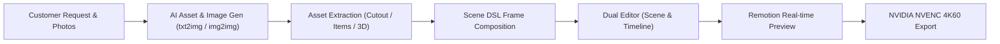
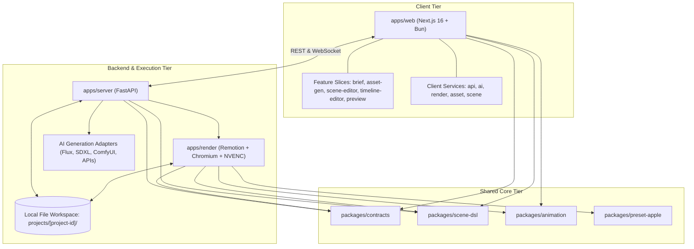
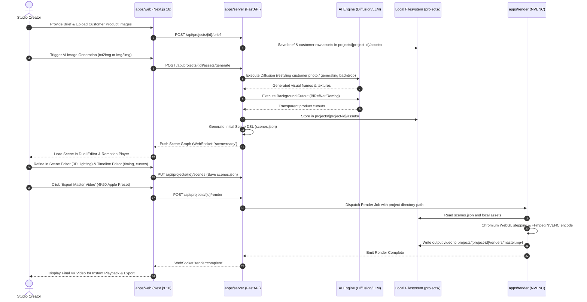

# PROJECT SPECIFICATION: AI-POWERED CINEMATIC VIDEO PRODUCTION STUDIO

> **Document Version:** 2.0.0  
> **Status:** Specification Complete / Greenfield Repository  
> **Target Frameworks:** Next.js 16 (React 19), Bun Workspaces, FastAPI (Python 3.11+)  
> **Target Audience:** System Architects, Software Engineers, AI/ML Engineers, Motion Designers  
> **Project Root:** `video-ai-demo`

---

## 1. Executive Summary & Product Vision

### 1.1 Vision Statement
The **AI Video Production Studio** is a specialized, pro-grade internal desktop/web studio tool engineered to generate high-end, cinematic product presentation videos, promotional trailers, brand teasers, and motion graphics inspired by the minimalist, ultra-sleek aesthetic of **Apple iPhone and Mac launch trailers**.

The studio enables creators and video professionals to take client requests and creative briefs—alongside optional customer product photos—and transform them into polished, broadcast-quality 60fps MP4 product trailers through a seamless hybrid pipeline:
1.  **AI Image & Asset Synthesis:** Generating initial visuals from scratch (text-to-image) or restyling customer product photos (image-to-image), extracting transparent product cutouts, generating 3D models/mockups, and producing studio lighting backdrops.
2.  **Item & Frame Composition:** Assembling visual elements, kinetic typography, dynamic lighting, and camera paths into declarative scenes using a structured Scene DSL.
3.  **Interactive Dual Editing:** Fine-tuning spatial layout and 3D positioning in the **Scene Editor**, and sequencing timing, transitions, audio beats, and keyframe spring physics in the **Timeline Editor**.
4.  **Hardware-Accelerated Rendering:** Previewing in real time in the browser via `@remotion/player`, and exporting final 4K60 master videos via headless Chromium and **NVIDIA NVENC hardware encoding**.



### 1.2 Core Design Aesthetic: "Apple-Style" Cinematic Trailer
Apple keynote presentations and hardware trailers feature a distinctive visual language that generic video generators cannot replicate:
*   **Minimalist, High-Contrast Staging:** Pure black (#000000 / #050505) or pristine studio gray backdrops with precise negative space and zero visual clutter.
*   **Organic Spring Physics:** Buttery smooth animations driven by physical spring dynamics (`mass`, `stiffness`, `damping`) rather than standard ease-in/ease-out curves.
*   **Studio Lighting & Specular Edge Sweeps:** High-intensity directional rim lights tracing product bevels, metallic anodized surfaces, subtle glass refractions, and contact ambient occlusion shadows.
*   **Macro Focal Sweeps & 3D Depth:** Virtual camera focal transitions, shallow depth-of-field, subtle parallax drifts, and orbital camera arcs around 3D hero assets.
*   **Kinetic Micro-Staggered Typography:** Restrained, bold typographic headlines revealing word-by-word with tracking expansion and masked vertical wipe reveals.

#### Apple-Style Mathematical Motion Specifications
1.  **Second-Order Spring Solver:**
    $$F(t) = -k(x - x_0) - c\dot{x}$$
    *   Stiffness $k \in [150, 240]$, Damping $c \in [14, 20]$, Mass $m = 1.0$.
    *   Target damping ratio $\zeta = \frac{c}{2\sqrt{km}} \approx 0.85$ (snappy response, natural organic settling without unnatural oscillation).
2.  **Kinetic Stagger Intervals:**
    $$t_{\text{start}}(i) = t_0 + i \cdot \Delta t, \quad \Delta t \in [3, 5]\text{ frames at } 60\text{ fps}$$
3.  **Rim Light Reflection Formulation:**
    $$\mathbf{I}_{\text{rim}} = I_0 \cdot \max(0, \mathbf{n} \cdot \mathbf{v})^2 \cdot (1 - \mathbf{n} \cdot \mathbf{l})$$

### 1.3 Architecture Simplification & Technology Rationalization
To serve as an efficient, high-velocity internal studio tool without unnecessary enterprise friction:
*   **Zero Authentication Overhead:** No login screens, OAuth2, or JWT tokens. The tool runs directly for the user on local workstation or private internal network.
*   **No Heavyweight Database Server:** Heavy PostgreSQL, pgvector, and Alembic migrations are eliminated. Instead, projects use a clean **File-Based Project Workspace** architecture with local JSON and SQLite indexing:
    *   Each project is a self-contained directory (`projects/<project-id>/`).
    *   `project.json` stores metadata, brief parameters, and color palettes.
    *   `scenes.json` stores the declarative Scene DSL AST.
    *   `assets/` holds raw customer uploads, AI-generated images, transparent cutouts, 3D `.glb` files, and audio tracks.
    *   `renders/` holds cached frame chunks and exported master MP4 videos.
    *   Projects can be backed up as zip archives, versioned with git, or moved seamlessly across machines.
*   **Bun as Universal Runtime & Package Manager:** Bun replaces pnpm/npm across all TypeScript workspaces, providing ultra-fast installation, native TypeScript execution, and rapid build times.
*   **Next.js 16 (React 19):** Next.js 16 App Router with Turbopack powers the frontend studio UI using a clean **Feature-Sliced Architecture**.

---

## 2. Truth in Documentation: Implementation Status

To maintain architectural integrity, this document explicitly distinguishes between what is currently implemented in code and the planned production architecture.

| Component / Layer | Target Architecture | Current Repository Status | Verification Source |
| :--- | :--- | :--- | :--- |
| **Monorepo Structure** | Bun workspaces (`apps/*`, `packages/*`) | **Scaffolded (Empty Directories)** | Repository file tree |
| **`apps/web`** | Next.js 16, Feature Slices, Zustand, Remotion | **Planned (Not Implemented)** | No source files present |
| **`apps/server`** | FastAPI, File-Based Project Store, AI Adapters | **Planned (Not Implemented)** | No source files present |
| **`apps/render`** | Remotion CLI, Headless Chromium, NVENC | **Planned (Not Implemented)** | No source files present |
| **`packages/contracts`** | Zod schemas, shared TypeScript interfaces | **Planned (Not Implemented)** | Directory unpopulated |
| **`packages/scene-dsl`** | Scene AST, parser, validator, interpolation runtime | **Planned (Not Implemented)** | Directory unpopulated |
| **`packages/animation`** | Spring physics curves, camera rigs, easing algorithms | **Planned (Not Implemented)** | Directory unpopulated |
| **`packages/preset-apple`** | Studio lighting, sleek typography, metallic shaders | **Planned (Not Implemented)** | Directory unpopulated |

> [!IMPORTANT]
> **Implementation Baseline:** The repository is currently a **greenfield workspace**. No application source code, API routes, or package configurations have been committed yet. All architectural specifications define the definitive target implementation.

---

## 3. Core Functional & Non-Functional Requirements

### 3.1 Functional Requirements (FR)
*   **FR-01: Brief & Customer Input Ingestion:** Direct intake of client goals, USPs, target duration, color codes, and customer product imagery.
*   **FR-02: AI Image-to-Image & Text-to-Image Generation:** 
    *   Generate visual assets from text prompts (e.g. dramatic dark studio backdrops, macro device parts).
    *   Transform customer product photos via image-to-image pipelines (restyling lighting, matching camera angles, placing products in Apple-style rigs).
*   **FR-03: Asset Cutout & Item Creation:** Automatic alpha background extraction (`rembg` / `BiRefNet`) to isolate product cutouts, generate texture maps, and produce 3D `.glb` product mockups.
*   **FR-04: Declarative Scene DSL Composition:** Automated and manual assembly of scenes, layers, typography, camera trajectories, and spring keyframes into a structured JSON AST.
*   **FR-05: Dual-Mode Interactive Editing:**
    *   *Scene Editor:* Spatial 3D/2D canvas inspector, transform gizmos, lighting rig controls, and real-time typography kerning.
    *   *Timeline Editor:* Multi-track temporal sequencer, keyframe curves, transition spans, audio waveforms, and playhead synchronization.
*   **FR-06: Real-Time In-Browser Preview:** Low-latency playback via `@remotion/player` and Three.js / React Three Fiber at 60fps.
*   **FR-07: Hardware-Accelerated NVENC Export:** Headless Chromium frame execution piped directly into NVIDIA NVENC (`h264_nvenc`, `hevc_nvenc`) for rapid 4K60 MP4 exports.

### 3.2 Non-Functional Requirements (NFR)
*   **NFR-01: Deterministic Frame Synthesis:** Repeated renders of an identical Scene DSL must produce pixel-identical frame outputs.
*   **NFR-02: Zero Server Complexity:** No mandatory external database or object storage services required to run the studio. Runs natively with local filesystem storage.
*   **NFR-03: Ultra-Fast Startup & Local Latency:** Bun-powered client dev server startup in $< 1\text{s}$, backend startup in $< 2\text{s}$.
*   **NFR-04: GPU Resource Efficiency:** Dedicated GPU memory guardrails and semaphore queuing to eliminate CUDA Out-Of-Memory exceptions during concurrent renders.

---

## 4. High-Level Architecture & Workspace Topology



### 4.1 Monorepo Structure
```text
video-ai-demo/
├── apps/
│   ├── web/                    # Next.js 16 frontend (Bun, Feature-Sliced UI, Remotion Player)
│   ├── server/                 # FastAPI backend (File-based workspace repo, AI orchestration)
│   └── render/                 # Remotion headless worker + Chromium + NVENC encoder
├── packages/
│   ├── contracts/              # Shared TypeScript types, Zod schemas, DTOs
│   ├── scene-dsl/              # Declarative Scene DSL specification & AST parser
│   ├── animation/              # Spring physics solvers, bezier curves, camera math
│   └── preset-apple/           # Apple-style typography presets, lighting rigs, shaders
├── projects/                   # Local file-based project workspaces (<id>/project.json, assets/)
├── docs/
│   ├── architecture/           # System, Data Flow, Render Pipeline, ADRs
│   ├── api/                    # REST contracts and WebSocket protocol specs
│   ├── workflows/              # Customer photo, img2img, asset cutout, and render flows
│   └── development/            # Coding standards and AI agent directives
├── CLAUDE.md                   # AI agent operational guidelines
├── PROJECT.md                  # Central project specification
└── README.md                   # Quickstart guide & repository index
```

---

## 5. End-to-End Production Workflow

The platform streamlines the creation of cinematic trailers from client inputs to final MP4:



---

## 6. File-Based Project Workspace & Domain Model

### 6.1 Project Directory Structure
Every project is completely self-contained on the local filesystem:
```text
projects/
└── iphone16-cinematic-intro/
    ├── project.json            # Project metadata, brand palette, target aspect ratio
    ├── scenes.json             # Complete Declarative Scene DSL AST
    ├── assets/
    │   ├── raw/                # Customer supplied source photos, logos
    │   ├── generated/          # AI text-to-image and image-to-image visuals
    │   ├── cutouts/            # Transparent PNG product cutouts
    │   ├── models3d/           # glTF / GLB 3D product models
    │   └── audio/              # BGM, voiceover, and SFX clips
    └── renders/
        ├── chunks/             # Intermediate rendered chunk MP4s (for caching)
        └── master_4k60.mp4     # Final exported master video
```

### 6.2 Declarative Scene DSL Schema
```typescript
export interface SceneCompositionDSL {
  version: "2.0.0";
  meta: {
    title: string;
    targetFps: 60;
    canvas: { width: 3840; height: 2160; aspectRatio: "16:9" };
    durationInFrames: number;
  };
  globalTheme: {
    palette: { background: "#050505"; primaryText: "#F5F5F7"; accent: "#2997FF" };
    lightingPreset: "studio-apple-dark";
  };
  scenes: SceneNode[];
  audioTracks: AudioTrackNode[];
}

export interface SceneNode {
  id: string;
  name: string;
  durationInFrames: number;
  transitionOut: {
    type: "lens-blur" | "fade-black" | "slide-spatial";
    durationInFrames: 24;
    springConfig: { mass: 1; stiffness: 180; damping: 14 };
  };
  camera: {
    type: "perspective";
    fov: 35;
    keyframes: { frame: number; position: [number, number, number]; target: [number, number, number] }[];
  };
  lighting: {
    preset: "apple-rim-spotlight";
    rimIntensity: 2.5;
    keyColor: "#FFFFFF";
    rimColor: "#4E95FF";
  };
  layers: (ImageLayerNode | TextLayerNode | Model3DLayerNode | ShapeLayerNode)[];
}
```

---

## 7. Technology Stack Summary

| Responsibility | Technology Choice | Architectural Justification |
| :--- | :--- | :--- |
| **Runtime & Workspaces** | **Bun (v1.1+)** | Unified package manager, fast install, native TS execution, zero config workspace management. |
| **Frontend Framework** | **Next.js 16 (React 19)** | App Router, Turbopack, Feature-Sliced modular architecture, modern UI. |
| **Video Playback** | **`@remotion/player` + Three.js** | Frame-accurate browser preview, WebGL shaders, synchronized audio. |
| **Client State** | **Zustand + Immer** | Decoupled atomic stores, zero playhead scrub lag, undo/redo temporal history. |
| **Backend API** | **FastAPI (Python 3.11+)** | High-performance async I/O, seamless integration with PyTorch/Diffusion/ComfyUI libraries. |
| **Project Storage** | **Local File-Based Workspaces** | Eliminates external DBs (Postgres/pgvector/MinIO); zero maintenance, portable projects. |
| **Hardware Video Encode** | **FFmpeg + NVIDIA NVENC** | Hardware-accelerated 4K60 encoding (`h264_nvenc`) directly from Chromium frame streams. |

---

## 8. Cross-Document Architecture Sitemap

*   **Frontend Studio Architecture:** [apps/web/ARCHITECTURE.md](apps/web/ARCHITECTURE.md)
*   **Backend Server Architecture:** [apps/server/ARCHITECTURE.md](apps/server/ARCHITECTURE.md)
*   **Render Engine Architecture:** [apps/render/ARCHITECTURE.md](apps/render/ARCHITECTURE.md)
*   **Shared Packages:** [packages/ARCHITECTURE.md](packages/ARCHITECTURE.md)
*   **System Overview:** [docs/architecture/SYSTEM_OVERVIEW.md](docs/architecture/SYSTEM_OVERVIEW.md)
*   **End-to-End Data Flow:** [docs/architecture/DATA_FLOW.md](docs/architecture/DATA_FLOW.md)
*   **Rendering Pipeline:** [docs/architecture/RENDERING_PIPELINE.md](docs/architecture/RENDERING_PIPELINE.md)
*   **Architecture Decisions (ADRs):** [docs/architecture/ARCHITECTURE_DECISIONS.md](docs/architecture/ARCHITECTURE_DECISIONS.md)
*   **API Contracts & Protocols:** [docs/api/API_CONTRACTS.md](docs/api/API_CONTRACTS.md)
*   **AI Workflows & Image Pipelines:** [docs/workflows/AI_WORKFLOWS.md](docs/workflows/AI_WORKFLOWS.md)
*   **Coding Standards:** [docs/development/CODING_STANDARDS.md](docs/development/CODING_STANDARDS.md)
*   **AI Agent Directives:** [CLAUDE.md](CLAUDE.md)
