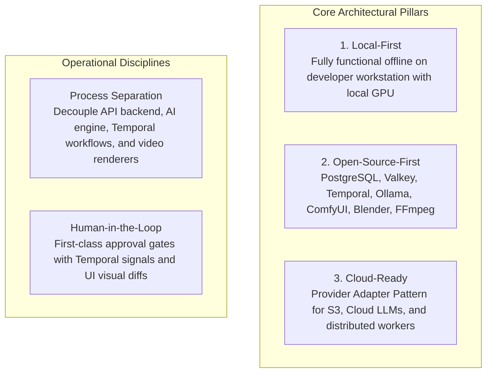
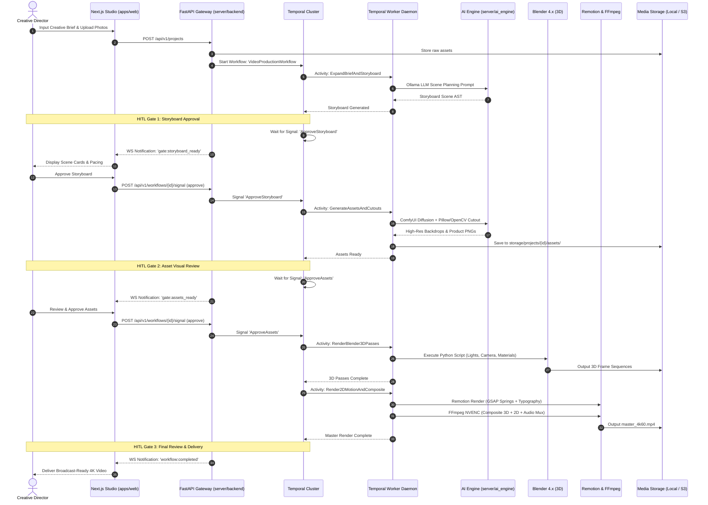

# PROJECT SPECIFICATION: AI MOTION STUDIO

> **Document Version:** 3.2.0  
> **Status:** Core Web Studio (11 screens with shadcn/ui) & Backend API Gateway Implemented  
> **Target Frameworks:** Next.js 16+ (React 19, Tailwind CSS v4, shadcn/ui), FastAPI 0.162+ (Python 3.11+, Pydantic v2), Temporal, PostgreSQL, Valkey, Blender 4.x, Remotion, FFmpeg  
> **Target Audience:** System Architects, AI Engineers, Fullstack Developers, Motion Designers  
> **Project Root:** `video-ai-demo`

---

## 1. Product Vision & Executive Summary

The **AI Motion Studio** is an automated video production platform engineered to produce premium, broadcast-grade cinematic product introduction videos, promotional trailers, brand teasers, and motion graphics inspired by the minimalist, ultra-sleek aesthetic of **Apple keynote presentations and hardware launch trailers**.

The platform bridges the gap between unstructured client requests and polished 60fps 4K MP4 deliverables through a cohesive hybrid pipeline combining:
* **Generative AI & LLM Planning:** Automated brief analysis, creative concept expansion, and structured storyboard scene planning.
* **Local Diffusion & Computer Vision:** Text-to-image synthesis, product photo restyling, transparent background isolation, and texture generation.
* **Programmatic 3D Staging:** Automated lighting rigs, camera sweeps, and material raytracing via **Blender** headless Python scripting.
* **Procedural 2D Motion Graphics:** Kinetic typography, physical spring oscillations, and real-time canvas overlays via **GSAP** and **Remotion**.
* **Audio Synchronization:** Automated sound design, beat-aligned transition cuts, and audio ducking.
* **Human-in-the-Loop (HITL) Governance:** Mandatory human review and approval gates at critical production milestones.

```mermaid
flowchart LR
    A["Client Brief & Raw Assets"] --> B["AI Creative Direction & Storyboarding"]
    B --> C["HITL Gate 1: Storyboard Signoff"]
    C --> D["Asset Gen (ComfyUI / Pillow / CV)"]
    D --> E["HITL Gate 2: Asset Signoff"]
    E --> F["3D Staging (Blender) & Motion (Remotion/GSAP)"]
    F --> G["Audio Sync & Post-Processing (FFmpeg)"]
    G --> H["HITL Gate 3: Final Master Approval"]
    H --> I["4K60 Broadcast Master MP4"]
```

---

## 2. Target Users & Business Use Cases

### 2.1 Target Audiences
1. **Brand & Product Marketing Teams:** Rapidly generating high-converting product launch trailers from raw product photography and bulleted feature lists without requiring 6-figure agency retainers.
2. **Motion Designers & Creative Directors:** Using AI-assisted layout, automated lighting rigs, and spring physics templates as a multiplier to bypass tedious keyframing.
3. **E-Commerce & DTC Brands:** Programmatically transforming catalog product listings into cinematic video advertisements tailored for social feeds and product landing pages.
4. **Agencies & Video Production Houses:** Accelerating pitch deck visualization and client review loops through instant storyboard mockups and rough-cut renders.

### 2.2 Primary Use Cases
* **Cinematic Hardware & Product Reveals:** Dramatic dark studio staging (#050505 backdrop), high-intensity rim light bevel sweeps, floating 3D perspective rotations, and macro focal depth-of-field zooms.
* **Feature Highlight Teasers:** Kinetic staggered typography revealing key technical specifications synchronized to musical beats and transition snaps.
* **Multi-Platform Aspect Ratio Re-targeting:** Automated re-composition from 16:9 widescreen master into 9:16 vertical reels and 1:1 square formats.

---

## 3. Implementation Status: Truth in Documentation

To maintain architectural integrity, this document explicitly distinguishes between what is currently implemented in code and the planned production architecture.

| Component / Layer | Target Architecture | Current Repository Status | Verification Source |
| :--- | :--- | :--- | :--- |
| **Monorepo Tooling** | Root workspace runner, PowerShell scripts | **Fully Implemented** | Root `package.json`, `scripts/` |
| **Web Studio (`apps/web`)** | Next.js 16.4+, React 19.3+, Tailwind v4.3+, shadcn/ui | **Fully Implemented (11 Screens)** | `apps/web/src/features/` |
| **API Gateway (`server/backend`)** | FastAPI 0.162+, Pydantic v2.14+, CORS | **Fully Implemented (16 Routes)** | `server/backend/src/` |
| **UI Design System** | 11 Production screen mockups | **Pixel-Matched in Code** | `UI Design/` $\leftrightarrow$ `apps/web/` |
| **AI Engine Services (`server/ai_engine`)** | Ollama LLM client, ComfyUI adapter, OpenCV, Pillow | **Scaffolded (Specification Complete)** | `server/ai_engine/` |
| **Worker Daemon (`worker`)** | Temporal Python Worker, Blender CLI, FFmpeg | **Scaffolded (Specification Complete)** | `worker/` |
| **Motion Engine (`apps/video-engine`)** | Remotion v4, GSAP 3.12+, Three.js canvas compositions | **Planned (Specification Complete)** | `apps/video-engine/` |
| **Database & Cache** | PostgreSQL 16 (Relational state), Valkey 7 (Cache/PubSub) | **Configured** | `docker-compose.infra.yml` |
| **Orchestration** | Temporal Server & Web UI | **Configured** | `docker-compose.infra.yml` |

> [!IMPORTANT]
> **Implementation Baseline:** The repository is currently a **greenfield architectural workspace**. All architectural specifications, data models, and workflow descriptions represent the authoritative blueprint for development.

---

## 4. UI Design System & Visual Blueprint (`UI Design/`)

The platform's frontend experience is grounded in 11 production UI mockups located in the `UI Design/` directory:

1. **Dashboard (`Dashboard.png`):** Studio overview, recent video projects, pipeline status, and performance metrics.
2. **Project Creation & Client Brief (`Project Creation & Client Brief.png`):** Client intake, USP input, aspect ratio, duration, and brand kit selection.
3. **Storyboard Studio (`Storyboard Studio.png`):** Multi-scene card matrix with visual pacing, camera prompts, and copy editing (HITL Gate 1).
4. **Asset Studio (`Asset Studio.png`):** AI image generation, prompt tuning, ComfyUI diffusion outputs, and transparent cutout controls (HITL Gate 2).
5. **Asset Library & Brand Kit (`Asset Library & Brand Kit.png`):** Reusable logos, product photos, 3D models, fonts, and brand color palettes.
6. **3D Scene Studio (`3D Scene Studio.png`):** WebGL/Three.js spatial viewport for inspecting 3D model orientation, materials, and camera paths.
7. **Scene & Motion Editor (`Scene & Motion Editor.png`):** Multi-track timeline, kinetic typography controls, and GSAP spring curves.
8. **Production Workflow (`Production Workflow.png`):** Visual trace of Temporal workflows, active activities, and execution logs.
9. **Approval Center (`Approval Center.png`):** Centralized Human-in-the-Loop review deck for side-by-side revision approvals.
10. **Render & Export Center (`Render & Export Center.png`):** Hardware NVENC encoding settings, bitrates, audio tracks, and 4K60 export (HITL Gate 3).
11. **Global AI Assistant (`Global AI Assistant.png`):** Persistent creative copilot for conversational brief expansion and styling tips.

---

## 5. Architectural Principles & System Baseline

The platform architecture is built upon three foundational pillars and two operational disciplines:

### 5.1 Process Separation Model
The system enforces strict operational boundaries across separate components:
1. **API Gateway (`server/backend`):** High-throughput, stateless FastAPI gateway handling HTTP/WebSocket ingress, authentication, project CRUD, PostgreSQL transactions, and Temporal workflow triggering.
2. **AI Processing Services (`server/ai_engine`):** Dedicated AI abstraction layer encapsulating Ollama LLM brief expansion, ComfyUI diffusion execution, and OpenCV/Pillow image processing.
3. **Orchestration Cluster (Temporal):** Manages durable workflow state machines, timers, approval signals, and execution history across restarts.
4. **Worker Daemons (`worker`):** Independent Python processes polling Temporal task queues, executing activities (calling `server/ai_engine`, Blender CLI scripts, and FFmpeg transcoding).
5. **Motion Engine Node (`apps/video-engine`):** Remotion WebGL rendering instances executed via headless Chromium subprocesses.

---

## 6. Functional Requirements (FR) by Workflow Stage

### Stage 1: Client Brief Analysis & Creative Direction
* **FR-1.1:** The system shall accept unstructured client briefs (text prompts, target audience, brand color palettes, font specifications, and duration constraints).
* **FR-1.2:** The system shall expand the client brief using an LLM (Ollama `llama3:8b` or cloud fallback via `server/ai_engine`) into a structured creative concept comprising visual themes, lighting styles, typography hierarchy, and emotional pacing.

### Stage 2: AI-Generated Storyboard & Scene Planning
* **FR-2.1:** The system shall generate a structured multi-scene storyboard JSON schema defining scene duration, camera trajectories, lighting parameters, headline copy, and visual asset requirements.
* **FR-2.2 (HITL Gate 1):** The system shall pause execution and present the storyboard to the creator in a visual card matrix (`Storyboard Studio.png`). The creator can approve, edit scene timing and copy directly, or reject with natural language feedback.

### Stage 3: Image Generation, Editing & Asset Processing
* **FR-3.1:** The system shall generate high-resolution scene background plates, textures, and product environments using diffusion models via **ComfyUI** (`server/ai_engine`).
* **FR-3.2:** The system shall process uploaded customer product photos using **OpenCV** and **Pillow** (automated background removal, color-grading adjustments, contrast curve harmonization).
* **FR-3.3 (HITL Gate 2):** The creator shall review processed assets in the UI (`Asset Studio.png`), with options to regenerate specific layers or upload manual cutout overrides.

### Stage 4: Scene Composition & Layer Management
* **FR-4.1:** The system shall maintain a declarative Scene Composition DSL representing visual layers (3D models, 2D raster cutouts, text layers, lighting rigs, and camera views).
* **FR-4.2:** The creator shall be able to reorder layers, adjust depth coordinates ($z$-index and 3D spatial offsets), and toggle visibility in the web studio.

### Stage 5: Motion Design, Keyframes & Visual Effects
* **FR-5.1:** The motion engine shall synthesize organic motion curves using second-order physical spring equations ($F = -kx - c\dot{x}$) powered by **GSAP** and **Remotion** (`apps/video-engine`).
* **FR-5.2:** Typography layers shall support micro-staggered word-by-word wipe reveals, letter-spacing expansions, and camera parallax tracking.

### Stage 6: 3D Production Using Blender
* **FR-6.1:** The worker shall execute headless Blender Python (`bpy`) scripts to instantiate 3D product geometries (`.glb`/`.gltf`), configure Apple-style studio lighting rigs (key, fill, and specular rim sweeps), and render 3D multi-pass sequences.
* **FR-6.2:** The web studio shall provide a real-time Three.js / WebGL preview canvas (`3D Scene Studio.png`) allowing creators to inspect 3D object rotation and camera angles interactively.

### Stage 7: Sound Design & Audio Synchronization
* **FR-7.1:** The system shall support multi-track audio sequencing (voiceover, background music, interface SFX, and transition swooshes).
* **FR-7.2:** The system shall detect audio beats and automatically duck background music during voiceover segments.

### Stage 8: Video Rendering, Post-Processing & Export
* **FR-8.1:** The compositor shall merge 3D Blender sequences, Remotion kinetic typography layers, and audio tracks using **FFmpeg**.
* **FR-8.2:** The export pipeline shall leverage **NVIDIA NVENC** (`h264_nvenc` / `hevc_nvenc`) for hardware-accelerated 4K60 encoding, with automatic fallback to high-quality CPU `libx264`.

### Stage 9: Human-in-the-Loop Signoff & Delivery
* **FR-9.1 (HITL Gate 3):** The completed master video shall be presented in the web player with frame-accurate scrubbing (`Render & Export Center.png`). The creator signs off on delivery or triggers localized scene revisions.

---

## 7. Non-Functional Requirements (NFR)

* **NFR-1 (Determinism):** Identical Scene DSL ASTs and seed parameters must yield pixel-identical video outputs ($\text{SSIM} \ge 0.999$).
* **NFR-2 (GPU Safety & Resource Management):** The worker daemon must enforce a concurrency semaphore (`GPU_CONCURRENCY_LIMIT`) to eliminate CUDA Out-Of-Memory exceptions during simultaneous diffusion and 3D rendering.
* **NFR-3 (Extensibility & Provider Adapters):** All AI and storage subsystems must implement abstract interfaces (`IAIProvider`, `IStorageService`) allowing zero-downtime provider substitution.
* **NFR-4 (Fault Tolerance & Durability):** Workflow state must be persisted across worker restarts and network drops using Temporal event sourcing.
* **NFR-5 (Modularity & File Length Budget):** All source code files must adhere to the 200-line modularity target, with a strict maximum limit of 300 lines per file.

---

## 8. Core Production Sequence Diagram

---

## 9. MVP Scope vs. Future Roadmap

```mermaid
flowchart LR
    subgraph MVP ["Phase 1: MVP Scope"]
        M1["Local-First Single Node Deployment"]
        M2["Ollama (Llama 3) Brief & Storyboard via ai_engine"]
        M3["ComfyUI Asset Gen & OpenCV Cutouts"]
        M4["Blender Headless 3D Studio Lighting"]
        M5["Remotion 2D Kinetic Typography"]
        M6["Temporal HITL 3-Stage Approval Gates"]
        M7["FFmpeg NVENC 4K60 Master Export"]
    end

    subgraph Phase2 ["Phase 2: Studio Enhancements"]
        P1["Multi-Track Audio Ducking & Waveforms"]
        P2["Interactive Spatial Transform Gizmos in Web"]
        P3["Procedural Glass & Anodized Metal Shader Presets"]
        P4["Cloud AI Provider Adapters (OpenAI / Claude)"]
    end

    subgraph Phase3 ["Phase 3: Cloud Scale"]
        C1["Distributed Multi-GPU Worker Cluster"]
        C2["AWS S3 / Cloudflare R2 Object Storage"]
        C3["Real-time Multi-User Collaborative Editing"]
        C4["Template Marketplace & Custom Plugin SDK"]
    end

    MVP --> Phase2 --> Phase3
```

---

## 10. Cross-Document Architecture Sitemap

* **System Architecture & Service Topology:** [SYSTEM_ARCHITECTURE.md](docs/architecture/SYSTEM_ARCHITECTURE.md)
* **Technology Stack & Licensing:** [TECH_STACK.md](docs/architecture/TECH_STACK.md)
* **AI Agent Operational Conventions:** [CLAUDE.md](CLAUDE.md)
* **Engineering & Coding Standards:** [CODING_STANDARDS.md](docs/development/CODING_STANDARDS.md)
* **Local Development Setup:** [LOCAL_SETUP.md](docs/development/LOCAL_SETUP.md)
* **Environment Variables Reference:** [ENVIRONMENT_VARIABLES.md](docs/development/ENVIRONMENT_VARIABLES.md)
* **Comprehensive Testing Strategy:** [TESTING_STRATEGY.md](docs/development/TESTING_STRATEGY.md)
* **Repository Readme:** [README.md](README.md)
