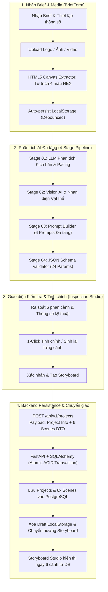

# Video AI Studio (`video-ai-demo`)

> **Hệ thống Sản xuất Video Quảng cáo Tự động bằng AI (AI-Native Video Production Studio)**  
> *Chuyển đổi yêu cầu kịch bản & hình ảnh/video của khách hàng thành video giới thiệu sản phẩm chuẩn điện ảnh 4K.*

---

## 🌟 Tổng quan Dự án

**Video AI Studio** là nền tảng sản xuất video ứng dụng AI toàn diện, tự động hóa toàn bộ quy trình từ khâu tiếp nhận brief, phân tích thị giác máy tính, tạo chuỗi prompt chi tiết cho từng phân cảnh, bố cục 3D/2D, cho đến render xuất bản video hoàn thiện:

* **Tự động lưu trữ (Zero Data Loss):** Tích hợp Zustand Persist Middleware tự động lưu nháp (`localStorage`) toàn bộ thông tin brief và 6 phân cảnh AI; chống mất dữ liệu khi F5 hoặc mất kết nối.
* **AI Tự động trích màu từ Logo (Canvas Extractor):** Tự động phân tích điểm ảnh của logo tải lên bằng HTML5 Canvas ($<8\text{ ms}$) để trích xuất 4 mã màu HEX chuẩn Studio.
* **Hệ thống Đa tác vụ AI 4 Giai đoạn (4-Stage AI Pipeline):**
  1. **Stage 01 · LLM Analysis:** Bóc tách thông điệp cốt lõi, chân dung đối tượng mục tiêu, 3 Key Hooks và tiến trình nhịp điệu (Story Pacing Arc).
  2. **Stage 02 · Vision AI Engine:** Trích xuất bảng màu HEX, nhận diện vật thể và đo độ khớp thương hiệu (Brand Match 98%).
  3. **Stage 03 · Prompt Builder Core:** Chuẩn hóa chuỗi 6 Visual Prompts đa tầng (Optics 85mm Anamorphic, Lighting 4:1 Rim, PBR Textures, Negative Prompts, Sampler DPM++ 2M Karras, Octane/UE5.4 Lumen 8K Photorealism).
  4. **Stage 04 · JSON Schema Validator:** Kiểm định 24/24 thông số kỹ thuật chuẩn Zod Schema tương thích Remotion & Blender.
* **Sinh lại từng Phân cảnh (Single-Scene AI Regeneration):** Cho phép tinh chỉnh hoặc sinh lại prompt riêng biệt cho 1 phân cảnh bất kỳ qua 4 presets 1-click (Điện ảnh, Kịch tính, Tối giản, Bóc tách 3D) mà không ảnh hưởng 5 cảnh còn lại.
* **Đồng bộ Trọn vẹn 6 Phân cảnh vào PostgreSQL:** Lưu trữ đồng thời `ProjectModel` và 6 `SceneModel` trong một giao dịch nguyên tử (ACID Transaction), sẵn sàng cho Storyboard Studio.
* **Pipeline Sản xuất 10 bước (Story ➔ Export):** Hỗ trợ cả 2 chế độ: *Phê duyệt thủ công (Human Approval)* và *Tự động chuyển bước (Always Proceed)*.
* **Giao diện Vibe Coding chuẩn Studio:** Khóa tràn viewport (`h-screen w-screen overflow-hidden`), zero-typing (1-click Radio Cards, Quick Pills, Switches) và 100% `cursor-pointer`.

---

## 🏗️ Kiến trúc Luồng Dữ liệu (End-to-End Workflow)



---

## 📋 Yêu cầu Hệ thống (Prerequisites)

Trước khi cài đặt, hãy đảm bảo máy tính đã cài:
1. **Node.js** $\ge$ 20.x hoặc **Bun** $\ge$ 1.1
2. **Python** $\ge$ 3.11 hoặc 3.12 (khuyên dùng môi trường ảo `.venv`)
3. **Git**
4. *(Tùy chọn)* **FFmpeg** & **NVIDIA GPU** (nếu render video tăng tốc phần cứng)

---

## ⚙️ Hướng dẫn Cài đặt (Installation)

### Bước 1: Clone mã nguồn
```bash
git clone https://github.com/your-org/video-ai-demo.git
cd video-ai-demo
```

### Bước 2: Thiết lập file môi trường
Tạo file `.env` từ file mẫu:
```bash
cp .env.example .env
```
> **Lưu ý:** Cấu hình chuỗi kết nối cơ sở dữ liệu `DATABASE_URL` (Supabase PostgreSQL hoặc PostgreSQL local) trong file `.env`.

### Bước 3: Cài đặt Backend (FastAPI Python)
Tạo môi trường ảo và cài đặt các thư viện:

**Trên Windows (PowerShell):**
```powershell
python -m venv .venv
.\.venv\Scripts\Activate.ps1
pip install -r server/backend/requirements.txt
```

**Trên macOS / Linux:**
```bash
python3 -m venv .venv
source .venv/bin/activate
pip install -r server/backend/requirements.txt
```

### Bước 4: Cài đặt Frontend (Next.js 16 Studio)
```bash
cd apps/web
bun install
# hoặc dùng npm:
# npm install
cd ../..
```

---

## 🚀 Hướng dẫn Khởi chạy Dự án (Running the Studio)

### Cách 1: Khởi chạy 1-Click (Khuyên dùng)
Khởi chạy đồng thời cả **Frontend Studio** và **Backend API Server**:

```bash
bun run dev
# hoặc dùng npm:
npm run dev
```

Hệ thống sẽ chạy tại:
* **Frontend Studio:** [http://localhost:3000](http://localhost:3000)
* **FastAPI Backend:** [http://localhost:8000](http://localhost:8000)

---

### Cách 2: Khởi chạy riêng lẻ từng dịch vụ (Dành cho Debug)

#### Terminal 1: Backend API Gateway (Port 8000)
**Windows PowerShell:**
```powershell
.\.venv\Scripts\python.exe -m uvicorn server.backend.src.main:app --host 0.0.0.0 --port 8000 --reload
```

**macOS / Linux:**
```bash
source .venv/bin/activate
python -m uvicorn server.backend.src.main:app --host 0.0.0.0 --port 8000 --reload
```

#### Terminal 2: Frontend Studio (Port 3000)
```bash
npm --prefix apps/web run dev
# hoặc:
# cd apps/web && bun run dev
```

---

## 🧪 Chạy Kiểm thử Tự động (Automated Tests)

### 1. Kiểm thử Tích hợp Backend & Đồng bộ 6 Phân cảnh
Kiểm tra endpoint `POST /api/v1/projects` và `GET /api/v1/projects/{id}/storyboard`:
```powershell
.\.venv\Scripts\python.exe server/backend/tests/test_project_creation_and_scenes_sync.py
```

### 2. Kiểm thử Type Safety Frontend (TypeScript)
```bash
bunx --cwd apps/web tsc --noEmit
```

### 3. Kiểm thử Đóng gói Production (Next.js Turbopack)
```bash
npm --prefix apps/web run build
```

---

## 🧹 Làm sạch Dữ liệu Database (Reset Data)

Dự án **không sử dụng mockdata/seed cứng**. Toàn bộ dữ liệu được tạo thực tế khi người dùng khởi tạo dự án trên giao diện.

Để dọn sạch database và bắt đầu lại từ đầu:
```bash
npm run db:clean
# hoặc chạy trực tiếp bằng python:
.\.venv\Scripts\python.exe server/backend/src/infrastructure/database/clean.py
```

---

## 🌐 Các Địa chỉ Truy cập (Endpoints)

| Dịch vụ | URL | Mô tả |
| :--- | :--- | :--- |
| **Studio Web UI** | [http://localhost:3000](http://localhost:3000) | Giao diện chính: Dashboard, Tạo dự án, Pipeline Studio |
| **Tạo mới Dự án** | [http://localhost:3000/projects/new](http://localhost:3000/projects/new) | Form nhập Brief 2 cột, phân tích AI & rà soát phân cảnh |
| **Storyboard Studio** | [http://localhost:3000/storyboard](http://localhost:3000/storyboard) | Xem và chỉnh sửa dòng thời gian 6 phân cảnh chi tiết |
| **Cài đặt Hệ thống** | [http://localhost:3000/settings](http://localhost:3000/settings) | Cấu hình chế độ duyệt, AI Models, GPU & Codec |
| **FastAPI Swagger Docs** | [http://localhost:8000/docs](http://localhost:8000/docs) | Tài liệu API tương tác trực tiếp (OpenAPI) |
| **API Health Check** | [http://localhost:8000/health](http://localhost:8000/health) | Kiểm tra trạng thái máy chủ backend |

---

## 📐 Tiêu chuẩn Giao diện & Vibe Coding

Toàn bộ dự án tuân thủ nghiêm ngặt các nguyên tắc trong [GEMINI.md](GEMINI.md) và [AGENTS.md](AGENTS.md):
1. **Khóa tràn Viewport (No Global Scroll):** Toàn màn hình khóa trong `h-screen w-screen overflow-hidden`; chỉ cho phép cuộn nội bộ mượt mà ở các khung chứa con (`flex-1 min-h-0 overflow-y-auto scrollbar-thin`).
2. **Không nhảy giao diện (No Layout Shift):** Tooltip & Popover bắt buộc dùng Radix Portal; số đếm đếm ngược sử dụng `font-mono tabular-nums`.
3. **Thao tác 1-Click (Zero-Manual Typing):** Ưu tiên Radio Cards, Dropdown Selects và Switches thay vì bắt người dùng gõ text thủ công.
4. **Trỏ chuột tương tác (`cursor-pointer`):** 100% nút bấm, thẻ và switch có `cursor-pointer`.
5. **Ngân sách mã nguồn:** $\le 200$ dòng code mỗi file (giới hạn cứng tối đa 300 dòng).

---

## 📄 License

Dự án phát hành theo giấy phép **MIT License**.
