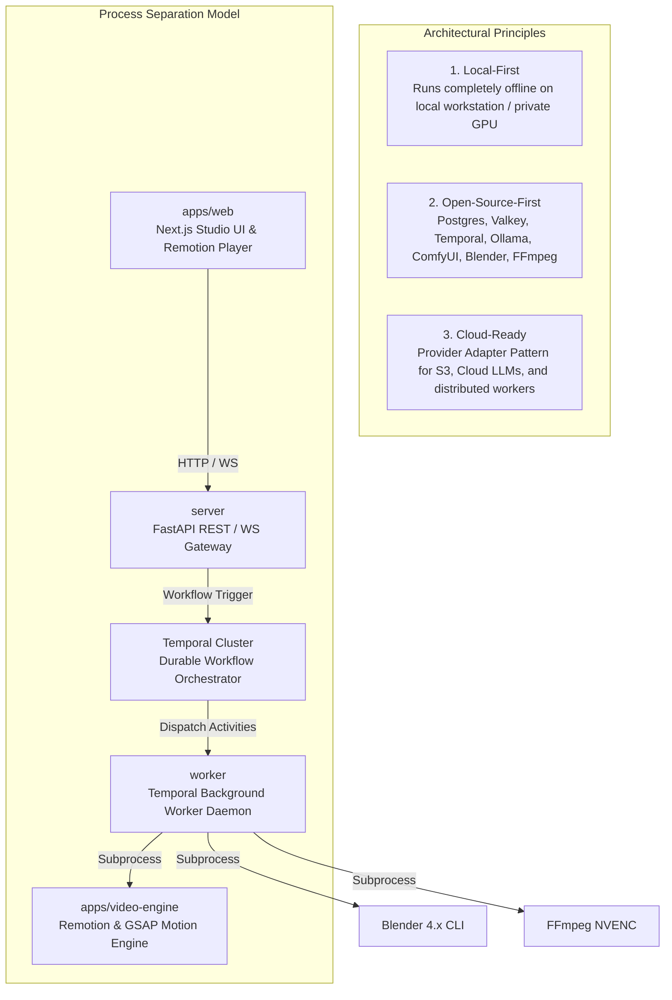

# AI Motion Studio (`video-ai-demo`)

> **Automated Cinematic Video Production Platform**  
> *Transforming Client Briefs & Product Imagery into Broadcast-Quality 4K60 Product Launch Trailers*

---

## 🌟 Executive Overview

**AI Motion Studio** is an open-source, local-first video production platform designed to automate end-to-end commercial video production for real client briefs. Inspired by the sleek, minimalist aesthetics of **Apple keynote announcements and hardware launch trailers**, the studio combines modern AI reasoning, local image diffusion, programmatic 3D raytracing, and code-driven motion design.

The platform streamlines what traditionally required a multidisciplinary agency team into an integrated, human-steered software pipeline:
* **Client Brief Analysis & Creative Direction:** Automated expansion of unstructured client requests, target audiences, and brand palettes into actionable creative concepts.
* **AI-Generated Storyboard & Scene Planning:** Intelligent generation of multi-scene plans, camera trajectories, typography copy, and visual timing.
* **Image Synthesis & Asset Processing:** Text-to-image and image-to-image product restyling via **ComfyUI** (Flux/SDXL), transparent cutouts via **OpenCV**, and color-curve matching with **Pillow**.
* **Scene Composition & Layer Management:** Declarative Scene DSL managing 3D models, raster cutouts, kinetic typography, and studio lighting rigs.
* **Organic Motion Design & Visual Effects:** Second-order physical spring physics ($F = -kx - c\dot{x}$), micro-staggered typography reveals, and camera parallax powered by **GSAP** and **Remotion**.
* **3D Production Using Blender:** Automated 3D scene staging, material physics (metallic, glass, anodized aluminum), and specular rim light sweeps executed via headless **Blender 4.x Python API (`bpy`)**, with real-time **Three.js** in-browser preview.
* **Sound Design & Audio Synchronization:** Beat-aligned scene transition cuts, multi-track audio sequencing, and automated voiceover ducking.
* **Hardware-Accelerated Video Rendering:** Compositing 3D and 2D passes and encoding master 4K60 MP4 deliverables using **FFmpeg** and **NVIDIA NVENC** (`h264_nvenc`).
* **Human-in-the-Loop (HITL) Governance:** Mandatory human review, editing, and approval gates at critical milestones (Storyboard, Assets, Final Master).

---

## 🏗️ Architecture & Core Principles

The platform is designed around three architectural pillars and one operational discipline:



1. **Local-First:** Full end-to-end functionality on a single workstation without mandatory cloud accounts or subscription APIs.
2. **Open-Source-First:** Eliminates proprietary vendor lock-in by utilizing community-backed open-source engines (**Valkey** over Redis, **Blender** for 3D, **Ollama** and **ComfyUI** for AI, **Temporal** for orchestration).
3. **Cloud-Ready:** Standardized Provider Adapter interfaces allow instant migration to AWS S3, Cloudflare R2, cloud GPUs, and managed container clusters.
4. **Decoupled Process Separation:** Lightweight API handling is strictly separated from long-running Temporal workflows, background worker daemons, and GPU-intensive rendering workloads.

---

## 📊 Implementation Status: Truth in Documentation

The repository is currently an **architecturally scaffolded greenfield project**. All documentation reflects the authoritative target implementation.

| Subsystem / Component | Technology Baseline | Current Repository Status | Path / Location |
| :--- | :--- | :--- | :--- |
| **Monorepo Structure** | Multi-workspace directory layout | **Scaffolded (Empty Directories)** | Root directory |
| **Frontend Studio** | Next.js 15+, Tailwind, shadcn/ui, Remotion | **Planned (Specification Complete)** | `apps/web/` |
| **Motion Engine** | Remotion v4, GSAP 3.12+, Three.js | **Planned (Specification Complete)** | `apps/video-engine/` |
| **API Server** | FastAPI, Pydantic v2, SQLAlchemy 2.0, Alembic | **Planned (Specification Complete)** | `server/` |
| **Worker Daemon** | Temporal Python Worker, Ollama, ComfyUI | **Planned (Specification Complete)** | `worker/` |
| **Supporting Infra** | Docker Compose (PostgreSQL 16, Valkey 7, Temporal) | **Configured** | `docker-compose.infra.yml` |
| **Configuration** | Environment variable specification & template | **Configured** | `.env.example` |
| **Technical Documentation**| Complete architectural, development & testing guides | **Complete & Verified** | `docs/`, `PROJECT.md`, `CLAUDE.md` |

---

## 🗂️ Repository Structure

```text
video-ai-demo/
├── apps/
│   ├── web/                    # Next.js frontend (App Router, Tailwind, shadcn/ui, Remotion Player)
│   └── video-engine/           # Remotion video motion compositions, GSAP spring curves, shaders
├── server/                     # FastAPI backend (Pydantic v2, SQLAlchemy 2.0 Async, Alembic, Temporal client)
├── worker/                     # Temporal worker daemon (Workflows, Activities, Ollama, ComfyUI, Blender)
├── packages/                   # Shared DTO contracts, Scene DSL schemas, and common utilities
├── scripts/                    # Automation, render testing, and environment setup scripts
├── docs/
│   ├── architecture/           # System architecture, topology, and technology stack rationalizations
│   └── development/            # Coding standards, local setup, environment variables, testing strategy
├── docker-compose.infra.yml    # Docker Compose for PostgreSQL, Valkey, and Temporal Cluster
├── .env.example                # Canonical template for environment configurations
├── CLAUDE.md                   # AI agent instructions, coding constraints, and rules
├── PROJECT.md                  # Master product specification and workflow details
└── README.md                   # Repository overview & quickstart index (this document)
```

---

## 💻 Technology Stack Summary

| Domain | Core Technologies |
| :--- | :--- |
| **Frontend UI** | Next.js 15+, TypeScript Strict, Tailwind CSS, shadcn/ui, Lucide Icons, Zustand |
| **Interactive 3D / Video**| Three.js, React Three Fiber, `@remotion/player` |
| **Backend API** | Python 3.11+, FastAPI, Pydantic v2, SQLAlchemy 2.0 Async, Alembic |
| **Orchestration & Workflow**| Temporal (Python SDK, Temporal Server, Temporal Web UI) |
| **Database & Cache** | PostgreSQL 16 (Relational state), Valkey 7 (Cache, Session store, PubSub) |
| **Local AI Engines** | Ollama (`llama3:8b`), ComfyUI (Flux.1 / SDXL Diffusion workflows) |
| **Computer Vision** | Pillow 10+, OpenCV 4.9+ (alpha cutouts, color curve grading) |
| **2D Motion Engine** | Remotion v4, GSAP 3.12+ (organic second-order spring physics) |
| **3D Rendering Engine** | Blender 4.1+ (Headless Python API scripting, Cycles raytracing, EEVEE) |
| **Video Compositing** | FFmpeg 6.1+ & FFprobe (NVIDIA NVENC `h264_nvenc` acceleration) |
| **Storage Abstraction** | Local Filesystem provider $\rightarrow$ AWS S3 / MinIO provider |
| **Containerization** | Docker, Docker Compose |

---

## 🚀 Quickstart & Local Setup

### 1. Prerequisites
Ensure your workstation has the following installed:
* **Docker & Docker Compose** (for PostgreSQL, Valkey, and Temporal)
* **Python 3.11+**
* **Node.js 20+** or **Bun 1.1+**
* **Blender 4.1+** and **FFmpeg 6.1+** on your system `PATH`
* **Ollama** and **ComfyUI** (for local AI features)

### 2. Configure Environment
```bash
# Clone the repository
git clone https://github.com/your-org/video-ai-demo.git
cd video-ai-demo

# Copy environment configuration template
cp .env.example .env
```
*(Review and customize `.env` as detailed in [docs/development/ENVIRONMENT_VARIABLES.md](docs/development/ENVIRONMENT_VARIABLES.md))*

### 3. Start Core Infrastructure (Docker Compose)
Launch PostgreSQL 16, Valkey 7, and Temporal Server:
```bash
docker compose -f docker-compose.infra.yml up -d
```
Verify all containers are healthy:
```bash
docker compose -f docker-compose.infra.yml ps
```

### 4. Start Application Services

```bash
# Terminal 1: Backend API Server (FastAPI)
python -m venv .venv
source .venv/bin/activate  # On Windows: .venv\Scripts\Activate.ps1
pip install -r server/requirements.txt
cd server && alembic upgrade head
uvicorn src.main:app --host 0.0.0.0 --port 8000 --reload

# Terminal 2: Background Worker Daemon (Temporal)
source .venv/bin/activate  # On Windows: .venv\Scripts\Activate.ps1
pip install -r worker/requirements.txt
python -m worker.src.main

# Terminal 3: Studio Frontend (Next.js)
cd apps/web
bun install && bun run dev

# Terminal 4: Remotion Standalone Motion Preview
cd apps/video-engine
bun install && bun run preview
```

### 5. Access Dashboards & Health Checks
* **Studio Web UI:** [http://localhost:3000](http://localhost:3000)
* **FastAPI Interactive Docs:** [http://localhost:8000/docs](http://localhost:8000/docs)
* **Temporal Workflow Web UI:** [http://localhost:8233](http://localhost:8233)
* **Remotion Standalone Preview:** [http://localhost:3100](http://localhost:3100)
* **Ollama Local LLM Endpoint:** [http://localhost:11434](http://localhost:11434)
* **ComfyUI Interface:** [http://localhost:8188](http://localhost:8188)

---

## 🧪 Testing & Quality Assurance

The codebase enforces a five-tier testing strategy:

```bash
# 1. Run Python unit & integration tests
pytest server/tests worker/tests -v

# 2. Run Temporal workflow simulation tests with time-skipping
pytest worker/tests/workflows -v

# 3. Run frontend unit tests
cd apps/web && bun test

# 4. Verify rendering determinism (OpenCV SSIM >= 0.999)
python scripts/test_render_determinism.py --fixture tests/fixtures/sample_scene.json

# 5. Run end-to-end user journey tests (Playwright)
cd apps/web && bun run test:e2e
```

For complete details on test tiers, mock configurations, and CI pipelines, see [docs/development/TESTING_STRATEGY.md](docs/development/TESTING_STRATEGY.md).

---

## 📚 Complete Technical Documentation Index

| Document | Description | Path |
| :--- | :--- | :--- |
| **Master Product Specification** | Vision, Apple motion math, functional requirements, MVP scope | [PROJECT.md](PROJECT.md) |
| **AI Agent Directives** | Actionable guidelines, boundaries, and conventions for AI assistants | [CLAUDE.md](CLAUDE.md) |
| **System Architecture** | Service topology, process boundaries, data flows, and HITL patterns | [SYSTEM_ARCHITECTURE.md](docs/architecture/SYSTEM_ARCHITECTURE.md) |
| **Technology Stack & Decisions** | Technology selection, licensing boundaries (GPL/LGPL), and adapters | [TECH_STACK.md](docs/architecture/TECH_STACK.md) |
| **Coding Standards & Limits** | Clean Architecture, line length budgets, Python & TypeScript standards | [CODING_STANDARDS.md](docs/development/CODING_STANDARDS.md) |
| **Local Setup Guide** | Comprehensive installation guide, Docker Compose, and troubleshooting | [LOCAL_SETUP.md](docs/development/LOCAL_SETUP.md) |
| **Environment Variables** | Detailed reference of all configuration keys, defaults, and requirements | [ENVIRONMENT_VARIABLES.md](docs/development/ENVIRONMENT_VARIABLES.md) |
| **Testing Strategy** | Multi-tier testing methodology, determinism tests, and CI/CD pipelines | [TESTING_STRATEGY.md](docs/development/TESTING_STRATEGY.md) |

---

## 📄 License & Attribution

This project is licensed under the **MIT License**.  
External integrated software engines (Blender, ComfyUI, FFmpeg, PostgreSQL, Valkey, Temporal) operate as independent processes under their respective open-source licenses (GPL-3.0, LGPL, BSD-3-Clause, Apache 2.0). Refer to [docs/architecture/TECH_STACK.md](docs/architecture/TECH_STACK.md) for full licensing boundary analyses.
