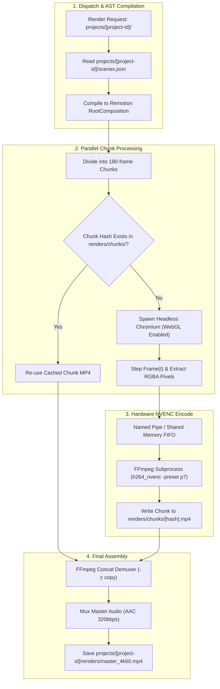

# RENDER ENGINE ARCHITECTURE SPECIFICATION: `apps/render`

> **Document Version:** 2.0.0  
> **Runtime:** Bun / Node.js, Remotion CLI, Headless Chromium  
> **Acceleration:** NVIDIA NVENC (`h264_nvenc`, `hevc_nvenc`), CUDA  
> **Storage:** Local Filesystem (`projects/<id>/`)  
> **Status:** Specification Complete / Greenfield Repository  
> **Parent Context:** [PROJECT.md](../../PROJECT.md)

---

## 1. Overview & Architectural Role

`apps/render` is the dedicated hardware-accelerated synthesis engine for the AI Video Production Studio. It executes deterministic React and WebGL components inside headless Chromium instances and pipes raw frame sequences directly into **NVIDIA NVENC hardware encoders** via FFmpeg.

### Key Performance Advantages
1.  **Zero-Network Local Asset Access:** Because projects reside on the local NVMe filesystem (`projects/<id>/assets/`), the render worker eliminates all remote S3/HTTP asset download overhead.
2.  **Chromium WebGL Hardware Acceleration:** Product models, metallic PBR shaders, dynamic rim lighting, and kinetic typography are evaluated with full GPU hardware rasterization.
3.  **NVENC Hardware Encoding:** Achieves $3\times$ to $10\times$ faster-than-realtime 4K60 video export with optimal broadcast bitrate and color gamut controls.
4.  **Local Chunk-Level Caching:** Renders are partitioned into 180-frame chunks stored in `projects/<id>/renders/chunks/`. Unmodified scenes are re-used instantly via FFmpeg stream copying (`-c copy`).

---

## 2. Implementation Status & Repository Baseline

| Component | Target Architecture | Repository Status | Verification |
| :--- | :--- | :--- | :--- |
| **Worker Dispatcher** | Local task consumer / IPC client | **Planned (0% Implemented)** | Directory unpopulated |
| **Scene DSL Compiler** | Remotion `<Composition>` AST builder | **Planned (0% Implemented)** | Directory unpopulated |
| **Chromium WebGL Runner** | Puppeteer cluster with GPU flags | **Planned (0% Implemented)** | Directory unpopulated |
| **NVENC Pipeline** | Raw RGBA $\to$ NV12 $\to$ FFmpeg `h264_nvenc` | **Planned (0% Implemented)** | Directory unpopulated |
| **Chunk Cache Manager** | Local filesystem hash-based cache | **Planned (0% Implemented)** | Directory unpopulated |

---

## 3. High-Level Synthesis Pipeline



---

## 4. Headless Chromium Hardware WebGL Flags

To render 3D product models with specular reflections at full 4K resolution, Chromium runs with explicit GPU flags:

```bash
google-chrome-stable \
  --headless=new \
  --disable-gpu-sandbox \
  --enable-gpu-rasterization \
  --enable-zero-copy \
  --use-gl=angle \
  --use-angle=gl-egl \
  --ignore-gpu-blocklist \
  --window-size=3840,2160 \
  --device-scale-factor=1 \
  --mute-audio \
  --disable-dev-shm-usage
```

---

## 5. NVIDIA NVENC Hardware Pipeline

Uncompressed RGBA frames are streamed into FFmpeg via a named pipe:

```bash
# Hardware 4K60 NVENC Command
ffmpeg -y \
  -f rawvideo \
  -vcodec rawvideo \
  -s 3840x2160 \
  -pix_fmt rgba \
  -r 60 \
  -i /tmp/render_pipe \
  -c:v h264_nvenc \
  -preset p7 \
  -tune hq \
  -profile:v high \
  -rc vbr \
  -cq 18 \
  -b:v 45M \
  -maxrate 60M \
  -bufsize 90M \
  -pix_fmt yuv420p \
  -color_primaries bt709 \
  -color_trc bt709 \
  -colorspace bt709 \
  -movflags +faststart \
  projects/iphone16-cinematic-intro/renders/chunks/chunk_0.mp4
```

---

## 6. Directory Structure

```text
apps/render/
├── src/
│   ├── index.ts                       # Worker entrypoint / CLI runner
│   ├── compiler/
│   │   ├── dsl-compiler.ts            # Compiles Scene DSL into Remotion tree
│   │   └── composition-builder.tsx    # Root Remotion composition
│   ├── runtime/
│   │   ├── ThreeCanvas.tsx            # Offscreen 3D WebGL renderer
│   │   ├── KineticText.tsx            # Kinetic typography animator
│   │   └── LightingRig.tsx            # 3-point studio lighting & rim sweeps
│   ├── pipeline/
│   │   ├── chromium-runner.ts         # Puppeteer Chromium stepping cluster
│   │   ├── frame-pipe.ts              # Named pipe IPC handler
│   │   ├── nvenc-encoder.ts           # FFmpeg NVENC process runner
│   │   └── stitcher.ts                # Audio-video muxer & chunk stitcher
│   └── cache/
│       └── chunk-cache.ts             # Local filesystem chunk hash manager
├── package.json
└── tsconfig.json
```

---

## 7. Cross-Document References

*   [PROJECT.md](../../PROJECT.md)
*   [RENDERING_PIPELINE.md](../../docs/architecture/RENDERING_PIPELINE.md)
*   [packages/ARCHITECTURE.md](../../packages/ARCHITECTURE.md)
