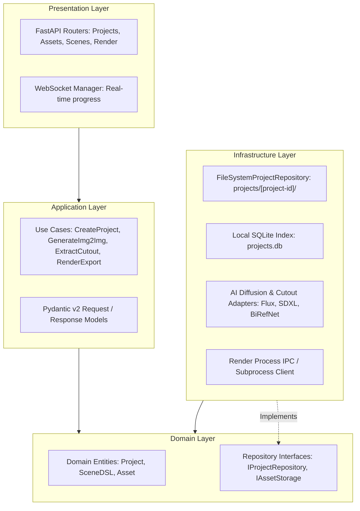
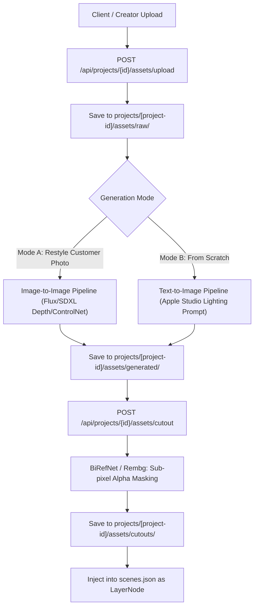

# BACKEND ARCHITECTURE SPECIFICATION: `apps/server`

> **Document Version:** 2.0.0  
> **Framework:** FastAPI (Python 3.11+), Pydantic v2  
> **Storage Strategy:** File-Based Project Workspaces + Local SQLite  
> **Status:** Specification Complete / Greenfield Repository  
> **Parent Context:** [PROJECT.md](../../PROJECT.md)

---

## 1. Architectural Philosophy: Clean, Lightweight, File-Based

`apps/server` is the orchestration engine for the AI Video Production Studio. It coordinates AI diffusion generation, customer photo restyling (img2img), transparent background extraction, Scene DSL AST synthesis, and local render dispatch.

To eliminate premature enterprise complexity, the backend rejects heavy external databases (PostgreSQL, pgvector) and S3 object servers in favor of **File-Based Project Workspaces**:
*   Every project lives in `projects/<project-id>/`.
*   Zero database connection setup or Docker database dependencies required.
*   Zero authentication overhead: runs directly on the local workstation or studio network without login tokens.
*   Strict **Clean Architecture (Hexagonal Architecture)** ensures business logic remains decoupled from filesystem APIs and external AI SDKs.



---

## 2. Implementation Status & Repository Baseline

| Layer / Component | Target Architecture | Repository Status | Verification |
| :--- | :--- | :--- | :--- |
| **FastAPI Core & Router** | FastAPI 0.110+, Async Lifespan | **Planned (0% Implemented)** | Directory unpopulated |
| **File-Based Repository** | `projects/<id>/` JSON + Asset store | **Planned (0% Implemented)** | Directory unpopulated |
| **AI Adapters (txt2img & img2img)**| Diffusion API / Local ComfyUI bridge | **Planned (0% Implemented)** | Directory unpopulated |
| **Cutout Processor** | `rembg` / `BiRefNet` background removal | **Planned (0% Implemented)** | Directory unpopulated |
| **Render Dispatcher** | Local subprocess / named pipe runner | **Planned (0% Implemented)** | Directory unpopulated |

---

## 3. File-Based Workspace Domain Model

Instead of a multi-table relational schema, each video production project is stored as a self-contained filesystem directory:

```text
projects/
└── <project_id>/
    ├── project.json            # Metadata, brief, brand colors, target resolution
    ├── scenes.json             # Complete Declarative Scene DSL AST
    ├── assets/
    │   ├── raw/                # Customer uploaded photos and logos
    │   ├── generated/          # AI txt2img and img2img outputs
    │   ├── cutouts/            # Transparent product PNGs
    │   ├── models3d/           # glTF / GLB 3D assets
    │   └── audio/              # Voiceover and soundtrack audio
    └── renders/
        ├── chunks/             # Intermediate rendered chunk MP4s
        └── master_4k60.mp4     # Final exported video
```

### 3.1 Repository Implementation Pattern
```python
# src/infrastructure/storage/file_system_repository.py
import json
import aiofiles
from pathlib import Path
from src.domain.interfaces import IProjectRepository
from src.domain.entities import Project, SceneDSL

class FileSystemProjectRepository(IProjectRepository):
    def __init__(self, base_dir: Path = Path("projects")):
        self.base_dir = base_dir
        self.base_dir.mkdir(parents=True, exist_ok=True)

    def _get_project_dir(self, project_id: str) -> Path:
        return self.base_dir / project_id

    async def get_project(self, project_id: str) -> Project | None:
        p_dir = self._get_project_dir(project_id)
        meta_file = p_dir / "project.json"
        if not meta_file.exists():
            return None
        async with aiofiles.open(meta_file, "r", encoding="utf-8") as f:
            data = json.loads(await f.read())
            return Project(**data)

    async def save_scenes(self, project_id: str, scenes: SceneDSL) -> None:
        p_dir = self._get_project_dir(project_id)
        scenes_file = p_dir / "scenes.json"
        async with aiofiles.open(scenes_file, "w", encoding="utf-8") as f:
            await f.write(scenes.model_dump_json(indent=2))
```

---

## 4. AI Image Generation & Customer Photo Workflow

A core capability of the backend is handling customer product photos and transforming them into Apple-style presentation assets:



1.  **Customer Photo Ingestion:** Raw client images (e.g. smartphone product shot) are uploaded directly to `assets/raw/`.
2.  **Image-to-Image Restyling:** The photo is processed through a diffusion pipeline using depth conditioning (ControlNet Depth / Canny) to preserve product geometry while replacing amateur lighting with dark Apple-style rim sweeps and reflections.
3.  **Background Removal (Cutout):** Product is segmented from the background using `BiRefNet` or `rembg` to produce transparent alpha PNGs ready for 3D spatial compositing.
4.  **Scene DSL Integration:** The cutout asset is bound to an `ImageLayerNode` or projected onto a 3D plane in `scenes.json`.

---

## 5. Directory Structure

```text
apps/server/
├── src/
│   ├── api/                           # Presentation Layer (FastAPI Routers)
│   │   ├── dependencies.py            # Service and repository providers
│   │   ├── middleware/                # CORS, Exception handling, Trace ID
│   │   ├── routers/
│   │   │   ├── projects.py            # Project creation & file workspace endpoints
│   │   │   ├── assets.py              # Customer upload, img2img, cutout endpoints
│   │   │   ├── scenes.py              # Scene DSL get / update endpoints
│   │   │   └── render.py              # Local NVENC render dispatch & progress
│   │   └── websockets/
│   │       └── progress_hub.py        # Real-time WebSocket event broadcaster
│   ├── application/                   # Application Layer (Use Cases)
│   │   ├── dtos/                      # Pydantic v2 schemas
│   │   └── use_cases/                 # Business logic orchestrators
│   ├── domain/                        # Domain Layer (Pure Python)
│   │   ├── entities/                  # Project, SceneDSL, Asset
│   │   └── interfaces/                # IProjectRepository, IAssetStorage, IAIEngine
│   ├── infrastructure/                # Infrastructure Layer
│   │   ├── ai/                        # Diffusion (Flux/SDXL), Rembg cutout adapters
│   │   ├── storage/                   # FileSystemProjectRepository
│   │   └── render/                    # Local Render Worker client
│   ├── config.py                      # Studio settings (directories, GPU limits)
│   └── main.py                        # FastAPI entrypoint
├── tests/
│   ├── unit/
│   └── integration/
├── pyproject.toml
└── README.md
```

---

## 6. Cross-Document References

*   [PROJECT.md](../../PROJECT.md)
*   [API_CONTRACTS.md](../../docs/api/API_CONTRACTS.md)
*   [AI_WORKFLOWS.md](../../docs/workflows/AI_WORKFLOWS.md)
*   [apps/render/ARCHITECTURE.md](../render/ARCHITECTURE.md)
