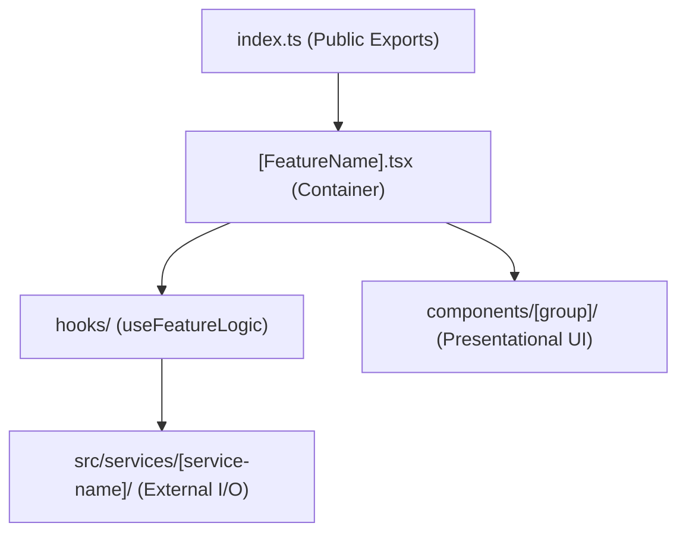

# FRONTEND ARCHITECTURE SPECIFICATION: `apps/web`

> **Document Version:** 2.0.0  
> **Framework:** Next.js 16 (React 19, Turbopack, App Router)  
> **Runtime & Tooling:** Bun (v1.1+)  
> **Status:** Specification Complete / Greenfield Repository  
> **Parent Context:** [PROJECT.md](../../PROJECT.md)

---

## 1. Overview & Architectural Principles

`apps/web` is the creative desktop/browser studio interface for the AI Video Production Studio. It provides a zero-auth, high-performance studio environment tailored for creating Apple-style product trailers and motion graphics.

### Key Architectural Tenets
1.  **Feature-Sliced Modular Architecture:** All UI logic is strictly compartmentalized under `app/features/<feature-name>/`, ensuring complete isolation, clean public APIs, and testability.
2.  **Centralized Client Services:** External network calls, AI generation triggers, render dispatchers, and project file I/O reside in `app/services/`.
3.  **Dual-Mode Creative Editing:** Fluid switching between **Scene Editor** (spatial 3D canvas, lighting, materials, typography) and **Timeline Editor** (temporal sequencer, spring keyframes, audio waveforms).
4.  **In-Browser Real-Time Playback:** `@remotion/player` integrated with Three.js / React Three Fiber for 60fps frame-accurate seeking and WebGL shader previews.
5.  **Zero-Lag Zustand State:** Fine-grained atomic subscriptions decoupled from the 60fps playhead clock to eliminate unnecessary React re-renders.

---

## 2. Implementation Status & Repository Baseline

| Subsystem | Target Architecture | Repository Status | Verification |
| :--- | :--- | :--- | :--- |
| **Next.js 16 App Shell** | App Router, React 19, Turbopack | **Planned (0% Implemented)** | Directory unpopulated |
| **Feature Slices (`src/features/*`)**| Feature modular pattern | **Planned (0% Implemented)** | Directory unpopulated |
| **Client Services (`src/services/*`)**| Centralized API & WS abstraction | **Planned (0% Implemented)** | Directory unpopulated |
| **Zustand State Stores** | Playback, Scene Graph, Temporal Undo/Redo | **Planned (0% Implemented)** | Directory unpopulated |
| **Remotion Player Canvas** | `@remotion/player` + R3F Canvas | **Planned (0% Implemented)** | Directory unpopulated |

---

## 3. Directory Structure

The frontend strictly adheres to the **Feature-Sliced Architecture** and **Centralized Services Pattern**:

```text
apps/web/
├── src/
│   ├── app/                           # Next.js App Router (Routing & Pages Only)
│   │   ├── layout.tsx                 # Global Root Shell (Theme, Providers)
│   │   ├── page.tsx                   # Project Showcase & Studio Dashboard
│   │   └── projects/
│   │       ├── new/page.tsx           # New Project Creation & Brief intake
│   │       └── [projectId]/
│   │           ├── layout.tsx         # Project Context & WebSocket Bridge
│   │           └── page.tsx           # Studio Workspace (Mounts Feature Containers)
│   │
│   ├── features/                      # Feature-Sliced Domain Modules
│   │   ├── brief-intake/              # Customer brief & customer asset upload
│   │   │   ├── BriefIntake.tsx        # Container Component (hooks & layout only)
│   │   │   ├── index.ts               # Public API (exports container & types)
│   │   │   ├── types.ts               # Internal feature types
│   │   │   ├── hooks/                 # useBriefForm, useCustomerUpload
│   │   │   └── components/            # Sub-components grouped by function
│   │   │       ├── form/              # BriefForm, ToneSelector
│   │   │       └── upload/            # AssetDropzone, ImagePreviewGrid
│   │   │
│   │   ├── asset-generator/           # AI text-to-image, img2img, cutout tools
│   │   │   ├── AssetGenerator.tsx     # Container Component
│   │   │   ├── index.ts               # Public API
│   │   │   ├── types.ts               # Generation prompts, cutout params
│   │   │   ├── hooks/                 # useDiffusionGen, useBackgroundRemoval
│   │   │   └── components/
│   │   │       ├── prompt-bar/        # PromptInput, StylePresetPicker
│   │   │       ├── preview/           # CutoutViewer, PBRMaterialTuner
│   │   │       └── gallery/           # AssetCard, CasAssetList
│   │   │
│   │   ├── scene-editor/              # Spatial 3D/2D stage inspector & canvas
│   │   │   ├── SceneEditor.tsx        # Container Component
│   │   │   ├── index.ts               # Public API
│   │   │   ├── types.ts               # TransformGizmoState, CameraControls
│   │   │   ├── hooks/                 # useSpatialTransform, useStudioLighting
│   │   │   └── components/
│   │   │       ├── viewport/          # ThreeCanvas, TransformGizmo, OrbitGrid
│   │   │       ├── inspector/         # LayerInspector, TypographyPanel, MaterialPicker
│   │   │       └── lighting/          # RimLightControl, KeyLightControl
│   │   │
│   │   ├── timeline-editor/           # Temporal sequencer, keyframe curves, audio
│   │   │   ├── TimelineEditor.tsx     # Container Component
│   │   │   ├── index.ts               # Public API
│   │   │   ├── types.ts               # TimelineTrack, KeyframeNode
│   │   │   ├── hooks/                 # useKeyframeCurves, useTrackSequencing
│   │   │   └── components/
│   │   │       ├── tracks/            # VisualTrack, AudioWaveformTrack, TransitionTrack
│   │   │       ├── curves/            # SpringCurveEditor, BezierSpline
│   │   │       └── ruler/             # TimeRuler, PlayheadScrubber, SnappingGuides
│   │   │
│   │   ├── video-preview/             # In-browser Remotion preview player
│   │   │   ├── VideoPreview.tsx       # Container Component
│   │   │   ├── index.ts               # Public API
│   │   │   ├── types.ts               # PlayerState, ResolutionPreset
│   │   │   ├── hooks/                 # useRemotionSync, usePlaybackShortcuts
│   │   │   └── components/
│   │   │       ├── player/            # RemotionPlayerWrapper, PlaybackControls
│   │   │       └── overlay/           # SafeAreasOverlay, ResolutionBadge
│   │   │
│   │   └── render-export/             # Hardware NVENC render monitor & export
│   │       ├── RenderExport.tsx       # Container Component
│   │       ├── index.ts               # Public API
│   │       ├── types.ts               # RenderProgress, ExportPreset
│   │       ├── hooks/                 # useRenderJob, useDownloadMaster
│   │       └── components/
│   │           ├── modal/             # ExportConfigModal, CodecSelector
│   │           └── progress/          # GpuProgressBar, ChunkStatusGrid
│   │
│   ├── services/                      # Client Services (Modular Service Folders)
│   │   ├── api/                       # Core HTTP & fetch client service
│   │   │   ├── index.ts               # Public API (export apiClient và types)
│   │   │   ├── types.ts               # RequestOptions, ApiResponse, ApiError
│   │   │   ├── client.ts              # Fetch wrapper, error envelope handling
│   │   │   └── interceptors.ts        # Timeout, traceId, headers interceptor
│   │   │
│   │   ├── websocket/                 # WebSocket real-time event dispatcher
│   │   │   ├── index.ts               # Public API (export wsService và types)
│   │   │   ├── types.ts               # WsMessage, WsSubscription, WsPayload
│   │   │   ├── socket.ts              # Connection management & auto-reconnect
│   │   │   └── handlers.ts            # Progress & job event dispatchers
│   │   │
│   │   ├── ai/                        # AI Image generation (txt2img & img2img)
│   │   │   ├── index.ts               # Public API (export aiService và types)
│   │   │   ├── types.ts               # Img2ImgOptions, Txt2ImgOptions, AiResponse
│   │   │   ├── client.ts              # Diffusion generation API calls
│   │   │   └── prompt-builder.ts      # Apple-style prompt assembly & style presets
│   │   │
│   │   ├── asset/                     # Customer photo upload, cutouts, 3D glTF
│   │   │   ├── index.ts               # Public API (export assetService và types)
│   │   │   ├── types.ts               # UploadProgress, CutoutResult, AssetMeta
│   │   │   ├── uploader.ts            # Multipart file upload handler
│   │   │   └── cutout.ts              # Background removal trigger & polling
│   │   │
│   │   ├── scene/                     # Scene DSL persistence & AST manipulation
│   │   │   ├── index.ts               # Public API (export sceneService và types)
│   │   │   ├── types.ts               # SceneSaveOptions, AstValidationResult
│   │   │   ├── persistence.ts         # scenes.json load & save operations
│   │   │   └── validator.ts           # Client-side AST schema verification
│   │   │
│   │   └── render/                    # Hardware NVENC render dispatch & progress
│   │       ├── index.ts               # Public API (export renderService và types)
│   │       ├── types.ts               # RenderJobConfig, ProgressStats, ExportResult
│   │       ├── runner.ts              # Dispatch render job, cancel job
│   │       └── telemetry.ts           # Frame speed, GPU VRAM, ETA calculators
│   │
│   └── stores/                        # Global Zustand Stores
│       ├── use-playback-store.ts      # High-frequency playhead & frame state
│       ├── use-scene-store.ts         # Active Scene DSL AST with undo/redo
│       └── use-project-store.ts       # Current project metadata
├── package.json
└── tsconfig.json
```

---

## 4. Feature Component Anatomy Pattern

Every feature in `src/features/<feature-name>/` strictly implements this uniform architecture:



### 4.1 Container Component Specification
The container component (`<FeatureName>.tsx`) never contains complex inline business logic. It connects hooks to presentational sub-components:

```tsx
// Example: src/features/asset-generator/AssetGenerator.tsx
'use client';

import React from 'react';
import { useDiffusionGen } from './hooks/use-diffusion-gen';
import { PromptInput } from './components/prompt-bar/PromptInput';
import { CutoutViewer } from './components/preview/CutoutViewer';
import { CasAssetList } from './components/gallery/CasAssetList';

export const AssetGenerator: React.FC<{ projectId: string }> = ({ projectId }) => {
  const { 
    prompt, 
    setPrompt, 
    generateAsset, 
    isGenerating, 
    generatedAssets 
  } = useDiffusionGen(projectId);

  return (
    <div className="flex h-full flex-col gap-4 p-4 bg-zinc-950 text-white">
      <PromptInput 
        value={prompt} 
        onChange={setPrompt} 
        onSubmit={generateAsset} 
        isLoading={isGenerating} 
      />
      <div className="grid flex-1 grid-cols-2 gap-4">
        <CutoutViewer activeAsset={generatedAssets[0]} />
        <CasAssetList assets={generatedAssets} />
      </div>
    </div>
  );
};
```

---

## 5. Client Services Architecture (`src/services/<service-name>/`)

Every service in `src/services/` is structured as a dedicated directory containing its own types, implementation files, and a clean public API index:

```text
src/services/<service-name>/
├── index.ts                # Public API (export service instance và các type công khai)
├── types.ts                # Kiểu dữ liệu / types nội bộ của service
└── <các file nghiệp vụ>    # client.ts, uploader.ts, handlers.ts, utils.ts
```

### 5.1 Service Implementation Example: `src/services/ai/`

```typescript
// 1. src/services/ai/types.ts
export interface Img2ImgOptions {
  sourceAssetPath: string;
  prompt: string;
  stylePreset?: 'apple-dark-studio' | 'apple-light-studio' | 'macro-detail';
  denoisingStrength?: number;
}

export interface Txt2ImgOptions {
  prompt: string;
  aspectRatio?: '16:9' | '9:16' | '1:1';
}

export interface GeneratedAssetResponse {
  assetPath: string;
  previewUrl: string;
}
```

```typescript
// 2. src/services/ai/client.ts
import { apiClient } from '@/services/api';
import { Img2ImgOptions, Txt2ImgOptions, GeneratedAssetResponse } from './types';

export const aiClient = {
  async generateTextToImage(projectId: string, options: Txt2ImgOptions): Promise<GeneratedAssetResponse> {
    return apiClient.post(`/api/projects/${projectId}/assets/generate/txt2img`, options);
  },

  async generateImageToImage(projectId: string, options: Img2ImgOptions): Promise<GeneratedAssetResponse> {
    return apiClient.post(`/api/projects/${projectId}/assets/generate/img2img`, {
      sourceAssetPath: options.sourceAssetPath,
      prompt: options.prompt,
      stylePreset: options.stylePreset ?? 'apple-dark-studio',
      denoisingStrength: options.denoisingStrength ?? 0.45,
    });
  },

  async extractCutout(projectId: string, assetPath: string): Promise<{ cutoutPath: string; hasAlpha: boolean }> {
    return apiClient.post(`/api/projects/${projectId}/assets/cutout`, { assetPath });
  }
};
```

```typescript
// 3. src/services/ai/index.ts
export { aiClient as aiService } from './client';
export type * from './types';
```

---

## 6. Remotion Web Preview Integration

The studio embeds `@remotion/player` within `src/features/video-preview/` to execute live frame rendering:

```tsx
// src/features/video-preview/components/player/RemotionPlayerWrapper.tsx
'use client';

import React from 'react';
import { Player } from '@remotion/player';
import { RootComposition } from '@/components/composition/RootComposition';
import { useSceneStore } from '@/stores/use-scene-store';
import { usePlaybackStore } from '@/stores/use-playback-store';

export const RemotionPlayerWrapper: React.FC = () => {
  const dsl = useSceneStore((state) => state.dsl);
  const currentFrame = usePlaybackStore((state) => state.currentFrame);
  const setFrame = usePlaybackStore((state) => state.setFrame);

  if (!dsl) return null;

  return (
    <div className="relative aspect-video w-full rounded-xl overflow-hidden bg-black shadow-2xl border border-zinc-800">
      <Player
        component={RootComposition}
        inputProps={{ dsl }}
        durationInFrames={dsl.meta.durationInFrames}
        fps={dsl.meta.targetFps}
        compositionWidth={dsl.meta.canvas.width}
        compositionHeight={dsl.meta.canvas.height}
        style={{ width: '100%', height: '100%' }}
        controls={false}
        loop
      />
    </div>
  );
};
```

---

## 7. Cross-Document References

*   [PROJECT.md](../../PROJECT.md)
*   [API_CONTRACTS.md](../../docs/api/API_CONTRACTS.md)
*   [AI_WORKFLOWS.md](../../docs/workflows/AI_WORKFLOWS.md)
*   [packages/ARCHITECTURE.md](../../packages/ARCHITECTURE.md)
