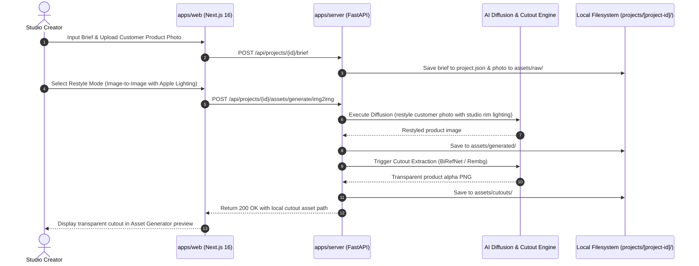
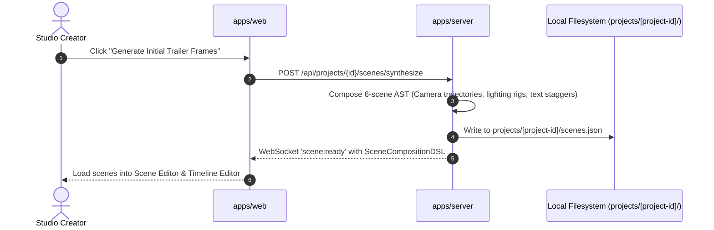
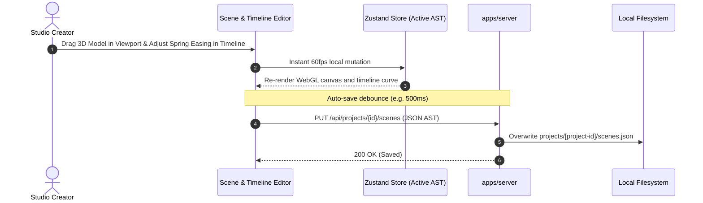
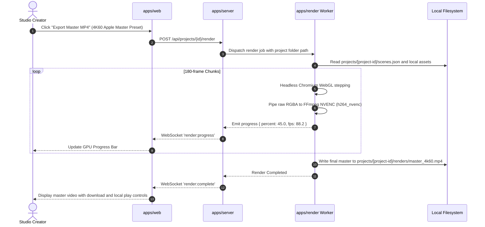
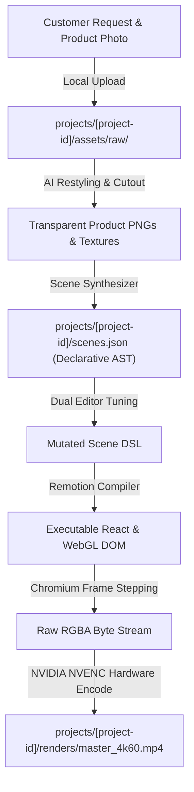

# END-TO-END DATA FLOW & SEQUENCE ARCHITECTURE

> **Document Version:** 2.0.0  
> **Toolchain:** Next.js 16 (Bun), FastAPI, Local File-Based Storage, NVIDIA NVENC  
> **Status:** Specification Complete / Greenfield Repository  
> **Parent Context:** [PROJECT.md](../../PROJECT.md)

---

## 1. Executive Summary & Flow Lifecycle

This document specifies the end-to-end data flow for the AI Video Production Studio. The workflow is designed specifically for creating Apple-style cinematic product presentations, promotional videos, and motion graphics based on customer requests.

The pipeline takes customer inputs (creative brief, branding, and customer product photos), processes them through AI image/cutout pipelines, composes them into a declarative Scene DSL, supports interactive dual-mode editing, and renders 4K60 video using NVIDIA NVENC hardware acceleration.

---

## 2. End-to-End Sequence Diagrams

### 2.1 Flow 1: Customer Input & AI Asset Creation (txt2img & img2img)

---

### 2.2 Flow 2: Frame Composition & Declarative Scene DSL

---

### 2.3 Flow 3: Interactive Dual-Editor Authoring & Local Persistence

---

### 2.4 Flow 4: Hardware NVENC Video Synthesis & Export

---

## 3. Data Transformations Across Boundaries

---

## 4. Cross-Document References

*   [PROJECT.md](../../PROJECT.md)
*   [SYSTEM_OVERVIEW.md](SYSTEM_OVERVIEW.md)
*   [RENDERING_PIPELINE.md](RENDERING_PIPELINE.md)
*   [AI_WORKFLOWS.md](../workflows/AI_WORKFLOWS.md)
*   [API_CONTRACTS.md](../api/API_CONTRACTS.md)
