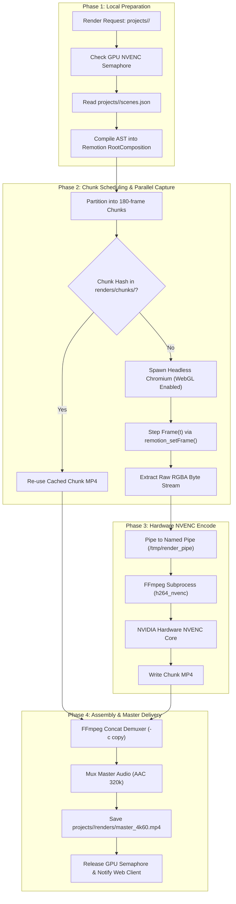

# RENDERING ENGINE & HARDWARE PIPELINE SPECIFICATION

> **Document Version:** 2.0.0  
> **Runtime:** Bun / Node.js, Remotion CLI, Headless Chromium  
> **Hardware Target:** NVIDIA RTX 3080/3090/4090, A10G, L4 (CUDA / NVENC)  
> **Storage:** Local Filesystem (`projects/<id>/`)  
> **Status:** Specification Complete / Greenfield Repository  
> **Parent Context:** [PROJECT.md](../../PROJECT.md)

---

## 1. Executive Summary & Hardware Purpose

The **Rendering Pipeline** is the computational core of the platform, converting declarative Scene DSL ASTs into broadcast-quality 4K 60fps video files. 

By coupling Remotion's React-based frame-accurate rendering runtime with headless Chromium WebGL hardware acceleration and **NVIDIA NVENC hardware encoding**, the pipeline eliminates the traditional performance bottlenecks of CPU-bound video synthesis.

### Zero-Latency Local Assets
Because the project workspace resides directly on the host NVMe filesystem (`projects/<project-id>/assets/`), the render worker loads high-resolution textures, glTF models, and transparent PNG cutouts instantly with zero network transmission latency.

---

## 2. High-Level Rendering Lifecycle



---

## 3. Headless Chromium Hardware WebGL Flags

Chromium is launched with explicit GPU acceleration flags:

```bash
google-chrome-stable \
  --headless=new \
  --disable-gpu-sandbox \
  --enable-gpu-rasterization \
  --enable-zero-copy \
  --use-gl=angle \
  --use-angle=gl-egl \
  --ignore-gpu-blocklist \
  --window-size=3840,2160 \
  --device-scale-factor=1 \
  --hide-scrollbars \
  --mute-audio \
  --disable-background-timer-throttling \
  --disable-dev-shm-usage
```

### Frame-Accurate Stepping
1.  Worker calls `window.remotion_setFrame(frameIndex)`.
2.  Chromium halts until all Three.js WebGL shaders and CSS spring transforms compute their state for that exact frame timestamp:
    $$t = \frac{\text{frameIndex}}{\text{fps}}$$
3.  The uncompressed frame buffer is read directly and pushed into the FFmpeg named pipe.

---

## 4. NVIDIA NVENC Hardware Encoding Parameters

```bash
ffmpeg -y \
  -f rawvideo \
  -vcodec rawvideo \
  -s 3840x2160 \
  -pix_fmt rgba \
  -r 60 \
  -i /tmp/render_pipe \
  -c:v h264_nvenc \
  -preset p7 \
  -tune hq \
  -profile:v high \
  -rc vbr \
  -cq 18 \
  -b:v 45M \
  -maxrate 60M \
  -bufsize 90M \
  -pix_fmt yuv420p \
  -color_primaries bt709 \
  -color_trc bt709 \
  -colorspace bt709 \
  -movflags +faststart \
  projects/<id>/renders/chunks/chunk_0.mp4
```

*   `-preset p7`: Highest quality encoding preset available on Ampere and Ada Lovelace architectures.
*   `-tune hq`: Tuning optimized for high-fidelity motion graphics and studio presentations.
*   `-rc vbr -cq 18`: Variable bitrate with Constant Quality target 18.
*   `-color_primaries bt709`: Enforces strict Rec.709 broadcast color standard.

---

## 5. Local Chunk-Level Caching & Determinism

1.  **Chunk Hash Computation:**
    $$\text{ChunkHash} = \text{SHA256}(\text{ChunkRange} + \text{SceneDSLSubtree} + \text{LocalAssetTimestamps} + \text{NVENCConfig})$$
2.  **Instant Re-renders:** If a creator modifies typography only in Scene 3 (frames 360–540), frames 0–359 are streamed directly from `renders/chunks/` without invoking Chromium or the GPU encoder, completing a 4K re-render in seconds.

---

## 6. Cross-Document References

*   [PROJECT.md](../../PROJECT.md)
*   [apps/render/ARCHITECTURE.md](../../apps/render/ARCHITECTURE.md)
*   [SYSTEM_OVERVIEW.md](SYSTEM_OVERVIEW.md)
*   [DATA_FLOW.md](DATA_FLOW.md)
