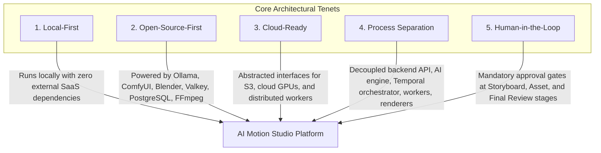
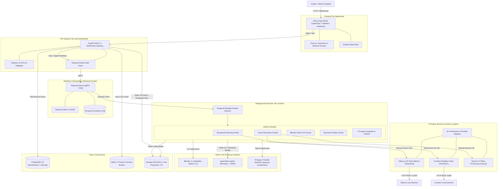

# SYSTEM ARCHITECTURE: AI MOTION STUDIO

> **Document Version:** 1.1.0  
> **Status:** Specification Complete / Greenfield Repository  
> **Architectural Baseline:** Local-first, Open-source-first, Cloud-ready  
> **Key Technologies:** Next.js, FastAPI, Temporal, PostgreSQL, Valkey, Ollama, ComfyUI, Blender, Remotion, FFmpeg  
> **Parent Context:** [PROJECT.md](../../PROJECT.md)

---

## 1. Architectural Vision & Core Principles

The **AI Motion Studio** is an enterprise-grade automated video production platform engineered to generate broadcast-quality product introduction trailers, promotional animations, and cinematic motion graphics.

The system translates unstructured client briefs and raw product imagery into 60fps cinematic video through a hybrid pipeline combining large language models, local diffusion models, programmatic 3D rendering (Blender), procedural 2D motion engines (Remotion & GSAP), and hardware-accelerated video compositing (FFmpeg).

### 1.1 Core Architectural Principles



1. **Local-First:** The complete platform operates out of the box on a developer workstation or private GPU server without requiring external cloud accounts or paid proprietary APIs.
2. **Open-Source-First:** Core production engines rely on foundational open-source tools: **Ollama** for local LLM reasoning, **ComfyUI** for diffusion-based asset generation, **Blender** for 3D physics and raytracing, **Valkey** for high-throughput caching, and **PostgreSQL** for relational state.
3. **Cloud-Ready:** All storage, AI engine, and worker interfaces implement the Provider Adapter Pattern. Local storage can seamlessly transition to AWS S3 / MinIO; local Ollama and ComfyUI can swap with cloud LLM/Diffusion endpoints; rendering workers scale horizontally across container clusters.
4. **Process Separation:** Heavy CPU/GPU operations (video encoding, 3D rendering, diffusion sampling) are strictly isolated from the user-facing API gateway (`server/backend`) and AI processing services (`server/ai_engine`). Workflows are orchestrated by **Temporal** to guarantee fault tolerance, execution history, and resumability.
5. **Human-in-the-Loop (HITL) by Design:** AI video production cannot rely on pure unattended automation. The architecture incorporates first-class human approval gates across the production timeline, allowing creators to review, steer, revise, or override any stage.

---

## 2. High-Level System Topology

The platform separates responsibilities into discrete, loosely coupled services communicating through standard protocols:



---

## 3. Subsystem Breakdown & Component Responsibilities

### 3.1 Frontend Web Studio (`apps/web`)
* **Role:** Interactive creative studio, brief intake, asset review, spatial canvas manipulation, timeline sequencing, and HITL approval interface.
* **Technology:** Next.js (React 19), TypeScript, Tailwind CSS, shadcn/ui components, Lucide icons, Zustand atomic stores.
* **UI Design Baseline:** Directly maps to the 11 screen blueprints in `UI Design/` (Dashboard, Storyboard Studio, Asset Studio, 3D Scene Studio, Scene & Motion Editor, Approval Center, Render & Export Center).
* **Capabilities:**
  * **Brief & Creative Studio:** Form interface for brand guidelines, color palettes, tone, target duration, and customer source assets.
  * **Storyboard Reviewer:** Visual card matrix presenting AI-generated scene plans, camera instructions, script copy, and visual timing.
  * **Interactive Dual Editor:** Three.js / WebGL viewport for inspecting 3D models and Remotion timeline scrub bar for 60fps frame scrubbing.

### 3.2 API Gateway & Orchestrator (`server/backend`)
* **Role:** HTTP/WebSocket ingress, authentication/workspace management, database transaction boundary, project CRUD, file uploads, and Temporal workflow controller.
* **Technology:** Python 3.11+, FastAPI, Pydantic v2, SQLAlchemy 2.0 (asyncio), Alembic, `temporalio` Python SDK.
* **Key Modules:**
  * `api/routers/`: Versioned REST endpoints (`/api/v1/projects`, `/api/v1/storyboards`, `/api/v1/assets`, `/api/v1/workflows`).
  * `api/websockets/`: Real-time bidirectional channel emitting step progress, frame render previews, and workflow notifications.
  * `domain/entities/`: Clean Architecture pure models (`Project`, `Scene`, `Asset`, `ApprovalGate`, `RenderJob`).
  * `infrastructure/database/`: PostgreSQL async engine, ORM entity mappings, and Alembic migration scripts.
  * `infrastructure/temporal/`: Client wrappers initiating workflows and delivering human-in-the-loop signals.

### 3.3 AI Engine & Vision Services (`server/ai_engine`)
* **Role:** Dedicated AI service layer abstracting generative LLM reasoning, diffusion workflows, and computer vision transformations.
* **Technology:** Python 3.11+, Pillow, OpenCV, HTTP clients for Ollama and ComfyUI.
* **Key Modules:**
  * `llm/`: Ollama prompt engineering for brief expansion and Scene DSL generation.
  * `diffusion/`: ComfyUI workflow graph generators for Flux.1 and SDXL studio lighting restyling.
  * `vision/`: Automated alpha cutout extraction (`BiRefNet` / `rembg`), edge detection, and color curve normalization via OpenCV and Pillow.
  * `adapters/`: Pluggable implementations of `IAIProvider` supporting seamless fallback to cloud models (OpenAI, Anthropic).

### 3.4 Workflow & Background Execution Daemon (`worker`)
* **Role:** Long-running, fault-tolerant execution of computationally heavy, multi-step production pipelines.
* **Technology:** Python 3.11+, Temporal Python Worker, Subprocess isolation.
* **Architecture:**
  * Built strictly on **Temporal Workflows and Activities**.
  * Workflows define the deterministic choreography: brief expansion $\rightarrow$ HITL gate $\rightarrow$ asset synthesis $\rightarrow$ HITL gate $\rightarrow$ 3D & 2D rendering $\rightarrow$ final post-processing $\rightarrow$ HITL signoff.
  * Activities call into `server/ai_engine` for AI generation, spawn Blender headless runs, and execute FFmpeg transcoding.
  * Enforces GPU semaphore guardrails (`GPU_CONCURRENCY_LIMIT`) to prevent CUDA OOM failures.

### 3.5 Video Motion & 3D Engines (`apps/video-engine`, Blender, FFmpeg)
* **Motion Engine (`apps/video-engine`):** Remotion and GSAP framework executing declarative Scene JSON into 60fps frame renders with spring physics.
* **3D Production Engine (Blender 4.x Headless):** Invoked via Python scripting (`bpy`) to render studio lighting, material physics, and orbital camera moves around product `.glb` models.
* **Post-Processing & Video Compositing (FFmpeg & FFprobe):** Composites 3D passes, Remotion overlays, and audio tracks into a master MP4 using **NVIDIA NVENC** (`h264_nvenc`).

### 3.6 Storage & Data Persistence Tier
* **Relational Database (PostgreSQL 16):** Persists projects, creative briefs, scene graphs, asset metadata, approval audit trails, and export jobs.
* **Cache & State Store (Valkey 7):** Open-source BSD-3-Clause Redis alternative handling ephemeral session states, rate limiting, and pub/sub.
* **Media Storage (Local Filesystem $\rightarrow$ S3 Provider):** Encapsulated behind `IStorageService` interface allowing local storage in development and S3/MinIO in production.

---

## 4. End-to-End Production Data Flow

```mermaid
sequenceDiagram
    autonumber
    actor Creator as Creative Director / User
    participant Web as Next.js Studio (apps/web)
    participant API as FastAPI Gateway (server/backend)
    participant DB as PostgreSQL
    participant Temporal as Temporal Orchestrator
    participant Worker as Temporal Worker Daemon
    participant AI as AI Engine (server/ai_engine)
    participant 3D as Blender 4.x
    participant Motion as Remotion & FFmpeg
    participant Storage as File / S3 Storage

    Creator->>Web: 1. Submit Client Brief & Brand Assets
    Web->>API: POST /api/v1/projects (brief, colors, duration)
    API->>DB: Create Project record (Status: DRAFT)
    API->>Storage: Store raw logos and customer product photos
    API->>Temporal: Start 'VideoProductionWorkflow(projectId)'
    Temporal-->>API: WorkflowExecutionStarted(runId)
    API-->>Web: 201 Created (projectId, runId)

    Note over Temporal,Worker: Step 1: Creative Brief & Storyboard Generation
    Temporal->>Worker: Execute Activity: ExpandBriefWithOllama()
    Worker->>AI: Call AI Engine: GenerateStoryboard(prompt)
    AI-->>Worker: Structured Storyboard JSON (scenes, pacing, camera, scripts)
    Worker->>DB: Store Storyboard & Scene models
    Worker-->>Temporal: StoryboardReady

    Note over Temporal,Creator: HITL Gate 1: Storyboard Approval
    Temporal->>Temporal: Await Signal: 'ApproveStoryboardSignal' (or Reject)
    API-->>Web: WebSocket 'workflow:waiting_approval' (Gate: Storyboard)
    Web-->>Creator: Present visual storyboard cards & scene plans
    Creator->>Web: Edits scenes & clicks 'Approve Storyboard'
    Web->>API: POST /api/v1/workflows/{id}/signal (approve)
    API->>Temporal: SignalWorkflowExecution('ApproveStoryboardSignal')

    Note over Temporal,Worker: Step 2: Asset Synthesis & Image Processing
    Temporal->>Worker: Execute Activity: GenerateSceneAssets()
    Worker->>AI: Call AI Engine: RunComfyUIWorkflow() + OpenCV Cutout
    AI-->>Worker: High-res background plates and product PNGs
    Worker->>Storage: Save processed assets to storage/projects/{id}/assets/
    Worker-->>Temporal: AssetsGenerated

    Note over Temporal,Creator: HITL Gate 2: Asset & Visual Staging Approval
    Temporal->>Temporal: Await Signal: 'ApproveAssetsSignal'
    API-->>Web: WebSocket 'workflow:waiting_approval' (Gate: Assets)
    Creator->>Web: Inspects generated backdrops & cutouts; clicks 'Approve'
    Web->>API: POST /api/v1/workflows/{id}/signal (approve)
    API->>Temporal: SignalWorkflowExecution('ApproveAssetsSignal')

    Note over Temporal,Worker: Step 3: 3D Staging, Motion Graphics & Compositing
    Temporal->>Worker: Execute Activity: RenderBlender3DScenes()
    Worker->>3D: Execute headless Python script (lights, camera paths, materials)
    3D->>Storage: Output 3D pass image sequences / MP4s
    Worker-->>Temporal: Blender3DRenderComplete

    Temporal->>Worker: Execute Activity: RenderMotionGraphics()
    Worker->>Motion: Remotion bundle & render frame sequences (GSAP springs)
    Motion->>Storage: Output 2D typography & overlay passes
    Worker-->>Temporal: MotionRenderComplete

    Temporal->>Worker: Execute Activity: CompositeMasterVideo()
    Worker->>Motion: FFmpeg NVENC (composite 3D + 2D + BGM + SFX ducking)
    Motion->>Storage: Write master_4k60.mp4
    Worker->>DB: Update RenderJob status to COMPLETED
    Worker-->>Temporal: WorkflowComplete

    Note over Temporal,Creator: HITL Gate 3: Final Review & Delivery
    API-->>Web: WebSocket 'workflow:completed' (download URL)
    Web-->>Creator: Deliver final 4K60 master video with one-click export
```

---

## 5. Architectural Boundaries & Communication Contracts

| Source Subsystem | Target Subsystem | Protocol | Payload Type | Responsibility |
| :--- | :--- | :--- | :--- | :--- |
| **`apps/web`** | **`server/backend`** | HTTPS / REST | JSON (Pydantic / Zod) | CRUD operations, project metadata, brief upload |
| **`apps/web`** | **`server/backend`** | WebSocket | JSON Event Stream | Live frame renders, workflow progress, HITL alerts |
| **`server/backend`** | **PostgreSQL** | TCP (Port 5432) | Asyncpg / SQL | Relational transactional persistence |
| **`server/backend`** | **Valkey** | TCP (Port 6379) | RESP (Redis Protocol)| Cache lookups, lock tokens, rate limits |
| **`server/backend`** | **Temporal Cluster**| gRPC (Port 7233) | Protobuf | Workflow start, cancellation, query, and signaling |
| **`worker`** | **Temporal Cluster**| gRPC (Port 7233) | Protobuf | Polling task queues, reporting activity heartbeats |
| **`worker`** | **`server/ai_engine`**| Python Module / IPC | Pydantic DTOs | Requesting LLM reasoning and ComfyUI generation |
| **`server/ai_engine`**| **Local Ollama** | HTTP (Port 11434)| JSON | Local LLM prompt completion and scene expansion |
| **`server/ai_engine`**| **Local ComfyUI**| HTTP (Port 8188) | JSON Graph Nodes | Diffusion workflow execution and asset extraction |
| **`worker`** | **Blender 4.x** | OS Subprocess | CLI flags & Python script | Headless 3D viewport rendering and Cycles/EEVEE passes |
| **`worker`** | **Remotion CLI** | Node Subprocess | JSON Scene AST | Headless WebGL frame rasterization |
| **`worker`** | **FFmpeg** | OS Subprocess / IPC | Raw RGBA Streams / Files | Hardware NVENC master MP4 multiplexing |

---

## 6. Cross-Document Sitemap

* **Detailed Technology Specifications & Licensing:** [TECH_STACK.md](TECH_STACK.md)
* **Master Product Requirements & Scope:** [PROJECT.md](../../PROJECT.md)
* **AI Agent Conventions & Operational Rules:** [CLAUDE.md](../../CLAUDE.md)
* **Engineering & Coding Standards:** [CODING_STANDARDS.md](../development/CODING_STANDARDS.md)
* **Local Development Environment Setup:** [LOCAL_SETUP.md](../development/LOCAL_SETUP.md)
* **Environment Variables Reference:** [ENVIRONMENT_VARIABLES.md](../development/ENVIRONMENT_VARIABLES.md)
* **Comprehensive Testing Strategy:** [TESTING_STRATEGY.md](../development/TESTING_STRATEGY.md)
