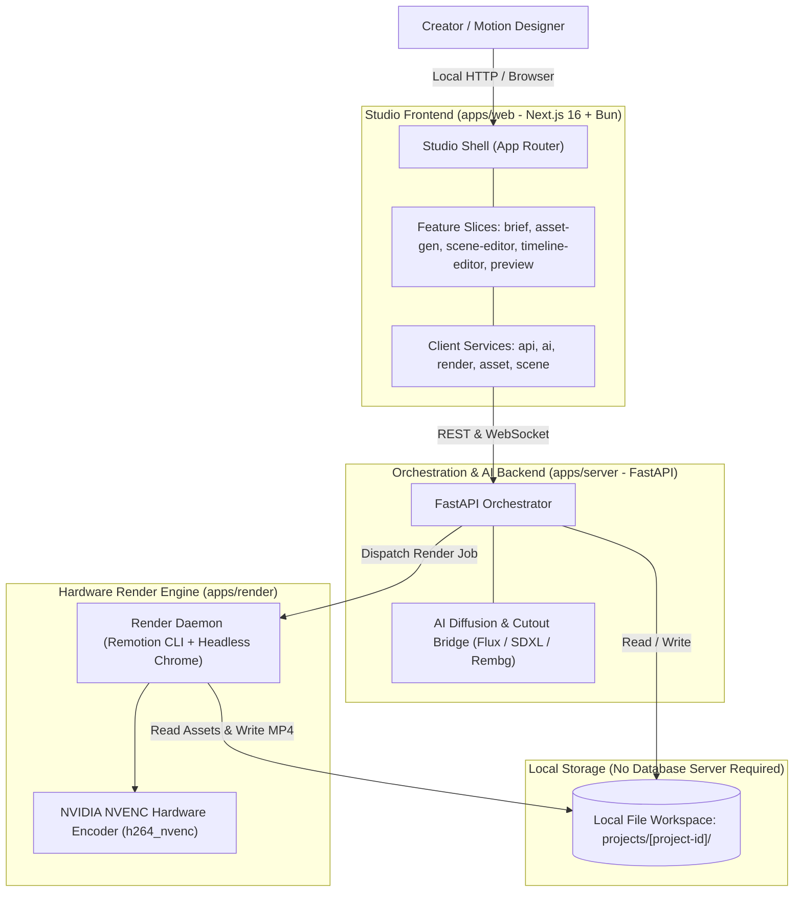

# SYSTEM ARCHITECTURE & SERVICE TOPOLOGY

> **Document Version:** 2.0.0  
> **Toolchain:** Next.js 16 (React 19), Bun (v1.1+), FastAPI, NVIDIA NVENC  
> **Status:** Specification Complete / Greenfield Repository  
> **Parent Context:** [PROJECT.md](../../PROJECT.md)

---

## 1. Executive System Overview

The **AI Video Production Studio** is engineered as a lean, pro-grade internal desktop/web studio tool designed to produce high-end, Apple-style cinematic product presentations, brand trailers, and motion graphics.

The architecture emphasizes zero maintenance overhead, maximum rendering speed, and deep local integration:
1.  **Frontend Studio (Next.js 16 + Bun):** Implements a **Feature-Sliced Architecture** (`app/features/`) and centralized client services (`app/services/`), embedding `@remotion/player` for live in-browser preview.
2.  **Orchestrator Backend (FastAPI):** Light async Python service coordinating AI diffusion generation (text-to-image and customer photo restyling), background cutout extraction (`BiRefNet`/`rembg`), and declarative Scene DSL assembly.
3.  **Local Project Workspace:** Eliminates heavy external databases (PostgreSQL/pgvector) and S3 object stores. All project metadata, Scene DSL ASTs, raw customer assets, and render chunks reside in the local filesystem under `projects/<id>/`.
4.  **Hardware-Accelerated Render Farm (`apps/render`):** Headless Chromium processes evaluate WebGL/Three.js frames and pipe uncompressed RGBA directly into **NVIDIA NVENC hardware encoders** (`h264_nvenc`).

---

## 2. System Topology & Architecture Diagram

---

## 3. Subsystem Responsibilities & Boundaries

### 3.1 Client Application (`apps/web`)
*   **Role:** User presentation, creative authoring, real-time preview.
*   **Structure:** Organized strictly into `src/app/` (routing tree), `src/features/<feature-name>/`, `src/services/<service-name>/`, and `src/stores/`.
*   **State:** Local Zustand stores managing playback time, active layer selection, and Scene DSL AST with undo/redo history.
*   **Auth:** Zero authentication: direct access for the studio creator.

### 3.2 Application Server (`apps/server`)
*   **Role:** Coordinates AI image generation, image-to-image restyling from customer photos, transparent cutout generation, and Scene DSL persistence.
*   **Storage Interface:** Implements `FileSystemProjectRepository` reading and writing directly to `projects/<project-id>/`.
*   **Decoupling:** Pure Clean Architecture domain entities isolated from external AI SDKs and local file I/O.

### 3.3 Render Engine (`apps/render`)
*   **Role:** High-speed 4K60 video synthesis.
*   **Execution:** Headless Chromium steps through Remotion frames, reading local textures and 3D `.glb` assets with zero network latency, streaming frames directly to NVIDIA NVENC.

---

## 4. Cross-Cutting Concerns

*   **Zero Database Overhead:** No PostgreSQL server, no pgvector indexing daemon, and no Alembic migration scripts to manage or maintain.
*   **Project Portability:** Every project is a single folder that can be zipped, archived, duplicated, or placed under git version control.
*   **GPU Guardrails:** Render jobs query local NVIDIA Management Library (NVML) before launching Chromium to prevent VRAM over-allocation.

---

## 5. Cross-Document References

*   [PROJECT.md](../../PROJECT.md)
*   [DATA_FLOW.md](DATA_FLOW.md)
*   [RENDERING_PIPELINE.md](RENDERING_PIPELINE.md)
*   [ARCHITECTURE_DECISIONS.md](ARCHITECTURE_DECISIONS.md)
*   [apps/web/ARCHITECTURE.md](../../apps/web/ARCHITECTURE.md)
*   [apps/server/ARCHITECTURE.md](../../apps/server/ARCHITECTURE.md)
