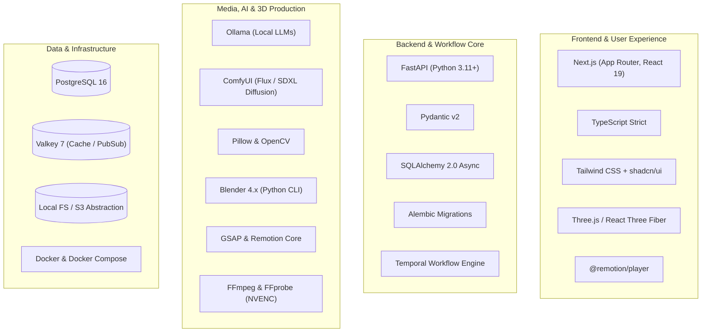
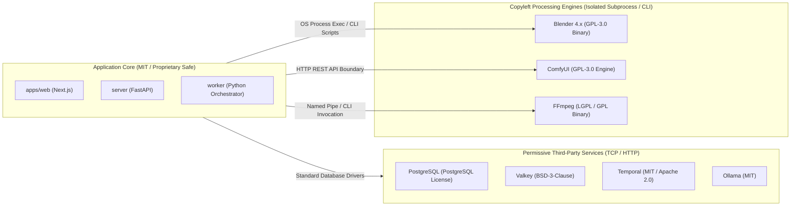
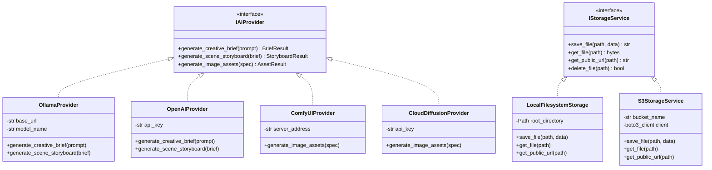
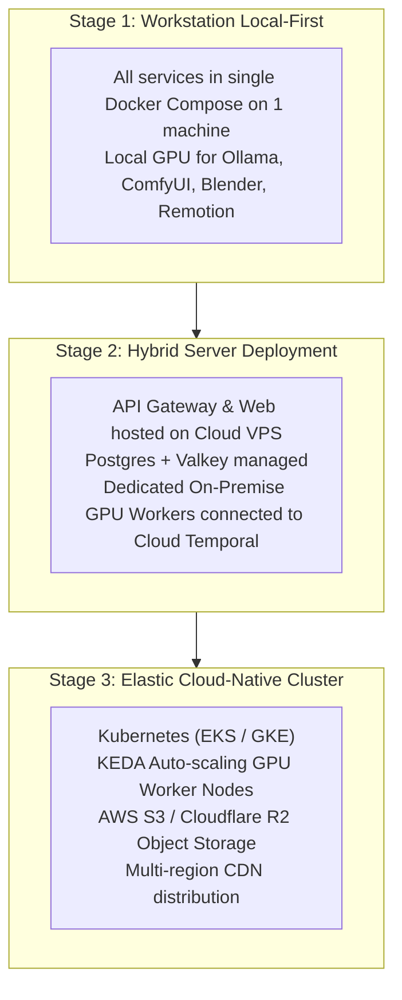

# TECHNOLOGY STACK & ARCHITECTURAL DECISIONS

> **Document Version:** 1.0.0  
> **Status:** Specification Complete / Greenfield Repository  
> **Parent Context:** [SYSTEM_ARCHITECTURE.md](SYSTEM_ARCHITECTURE.md) | [PROJECT.md](../../PROJECT.md)

---

## 1. Technology Selection Overview

The **AI Motion Studio** is built upon a curated selection of best-of-breed open-source technologies, local-first computing frameworks, and modern web standards. Each choice is evaluated against three core architectural tenets: **Local-First viability**, **Developer productivity**, and **Frictionless Cloud scalability**.



---

## 2. Comprehensive Technology Matrix

| Layer / Responsibility | Selected Technology | Version | License | Alternatives Evaluated | Rationale & Trade-off Analysis |
| :--- | :--- | :--- | :--- | :--- | :--- |
| **Frontend Framework** | **Next.js** | 15+ / 16 (React 19) | MIT | Vite + SPA, Remix | Next.js App Router provides optimal server-side routing, streaming SSR, built-in asset optimization, and unified fullstack ergonomics. |
| **Styling & Design System** | **Tailwind CSS + shadcn/ui** | Tailwind v3.4+, Radix UI | MIT | Material UI, Ant Design, Chakra UI | Zero-runtime CSS, fully copy-pasteable accessible primitives (shadcn), total theme customization suitable for a dark-mode creative studio. |
| **In-Browser 3D Viewport** | **Three.js / React Three Fiber** | Three.js r165+ | MIT | Babylon.js, PlayCanvas | De facto WebGL ecosystem standard. Allows interactive inspection of 3D `.glb` assets and virtual camera angles before triggering final Blender renders. |
| **In-Browser Video Playback** | **`@remotion/player`** | Remotion v4+ | Remotion License / Free Local | Video.js, HTML5 standard `<video>` | Frame-accurate playhead scrubbing, deterministic React canvas rendering, dynamic layer overlays, and frame-rate locking at 60fps. |
| **Client State Management** | **Zustand + Immer** | Zustand v4.5+ | MIT | Redux Toolkit, MobX, Jotai | Micro-sized footprint ($< 2\text{KB}$), atomic selector model preventing re-render storms during 60fps playhead scrubs, and zero-boilerplate immutable updates. |
| **API Server Framework** | **FastAPI** | 0.111+ (Python 3.11+) | MIT | Django, Flask, Express/Node.js | Asynchronous ASGI runtime, automatic OpenAPI generation, native Pydantic integration, and direct synergy with PyTorch, OpenCV, and AI libraries. |
| **Data Validation & DTOs** | **Pydantic v2** | 2.7+ | MIT | Marshmallow, Cerberus | Rust-backed performance ($15\times$ faster than v1), strict type coercion, automated JSON Schema generation for LLM structured outputs. |
| **Relational ORM & Engine** | **SQLAlchemy Async** | 2.0+ | MIT | Django ORM, Tortoise ORM, Peewee | Industry standard for complex enterprise data models, explicit transaction management, full async/await support via `asyncpg`. |
| **Database Migrations** | **Alembic** | 1.13+ | MIT | Flyway, Liquibase | First-class integration with SQLAlchemy metadata; autogenerates clean forward and backward migration scripts. |
| **Relational Database** | **PostgreSQL** | 16+ | PostgreSQL License (Open) | MySQL, SQLite | Robust ACID transactions, JSONB indexing for flexible Scene DSL ASTs, and future vector extension (`pgvector`) support if needed. |
| **Caching & Pub/Sub** | **Valkey** | 7.2+ / 8.0 | BSD-3-Clause | Redis, KeyDB, Memcached | Fully open-source Linux Foundation fork of Redis created after Redis adopted non-open SSPL/RSAL licenses. 100% protocol compatible. |
| **Workflow Orchestration** | **Temporal** | 1.24+ (Python SDK 1.5+) | Apache 2.0 (Server: MIT) | Celery, BullMQ, Apache Airflow | Durable execution, automatic state persistence, native support for multi-day workflows with human-in-the-loop signals, zero lost jobs on worker restarts. |
| **Local LLM Engine** | **Ollama** | 0.1.30+ | MIT | vLLM, llama.cpp, LocalAI | One-click setup on macOS, Linux, and Windows; supports modern open weights (Llama 3, Mistral, Qwen); clean HTTP API. |
| **Local Diffusion Engine** | **ComfyUI** | Latest Release | GPL-3.0 | Automatic1111, Diffusers API | Graph-based modular workflow engine, ultra-efficient VRAM allocation, native support for SDXL, Flux.1, ControlNet, and custom product inpainting. |
| **Image Processing** | **Pillow & OpenCV** | Pillow 10+, OpenCV 4.9+ | HPND / Apache 2.0 | ImageMagick, Scikit-image | High-speed C-backed image resizing, color curve adjustments, alpha channel masking, edge detection, and thumbnail generation. |
| **2D Motion Engine** | **Remotion & GSAP** | Remotion 4+, GSAP 3.12+ | Remotion (Free/Commercial), GSAP Standard | After Effects CLI, MoviePy | Programmatic code-driven motion design, second-order spring physics, word-by-word kinetic typography, and deterministic frame stepping. |
| **3D Rendering Engine** | **Blender Python API (bpy)** | Blender 4.1+ | GPL-3.0 (Isolated Subprocess) | Unreal Engine, Maya, POV-Ray | Unmatched open-source 3D raytracing (Cycles) and real-time viewport (EEVEE). Headless Python scripting enables automated lighting, material, and camera setup. |
| **Video Compositing & Transcoding** | **FFmpeg & FFprobe** | 6.1+ / 7.0 | LGPL v2.1+ / GPL v2+ | GStreamer, HandBrake CLI | Industry-standard multimedia pipeline; hardware NVENC/VAAPI encoding; multi-track audio multiplexing and filter graphs. |
| **Storage Abstraction** | **Local Filesystem / S3** | Custom `StorageService` | Internal MIT | Direct S3 SDK only | Encapsulated storage contract. Runs locally with standard path I/O, seamlessly toggles to S3/MinIO in cloud deployments. |
| **Containerization** | **Docker & Docker Compose** | Engine 26+, Compose v2.27+ | Apache 2.0 | Podman, Kubernetes | Declarative multi-container configuration defining local PostgreSQL, Valkey, Temporal, FastAPI, and worker daemon stacks. |

---

## 3. Deep-Dive Architectural Rationalizations

### 3.1 Why Temporal Over Traditional Task Queues (Celery / BullMQ)
Standard task queues (such as Celery or BullMQ) are designed for fire-and-forget background jobs that complete in seconds. AI video production has fundamentally different requirements:
1. **Durable State Across Hours/Days:** A complete video lifecycle may span hours while awaiting creative director reviews at HITL approval gates.
2. **First-Class Signals:** Temporal workflows pause execution indefinitely at `workflow.wait_condition()` without consuming thread or CPU resources, resuming instantly when a human approval signal arrives via HTTP/WebSocket.
3. **Automatic Crash Recovery:** If a rendering worker crashes mid-pipeline due to a power spike or OOM error, Temporal automatically re-dispatches the specific failed activity to a healthy worker with full execution history intact.
4. **Execution Auditability:** Temporal Web UI provides an interactive, visual step-by-step trace of every activity, timing metric, input payload, and retry attempt.

### 3.2 Why Valkey Over Redis
In March 2024, Redis transitioned from the open-source BSD license to dual proprietary source-available licenses (RSALv2 and SSPLv1), restricting cloud usage and enterprise distribution.
* **The Solution:** The Linux Foundation, backed by AWS, Google Cloud, Oracle, and Ericsson, launched **Valkey** as a direct, community-driven BSD-3-Clause continuation.
* **Compatibility:** Valkey maintains complete wire-protocol and API compatibility with standard Redis clients (including `redis-py` and `ioredis`), ensuring zero code friction while guaranteeing true open-source compliance.

### 3.3 The Hybrid Motion Pipeline: Remotion + GSAP + Blender
Modern cinematic product trailers require both realistic 3D physical interactions and sharp, responsive 2D motion graphics:
* **Blender 4.x (3D Heavyweight):** Produces realistic product materials (specular highlights on metallic phone bezels, glass refraction, contact shadows) and physical camera moves via the headless `bpy` Python API.
* **Remotion + GSAP (2D Kinetic & Typography):** Renders crisp, scalable typography, HUD badges, kinetic spring reveals, and color overlays in HTML/Canvas at native 4K resolution without the heavy render overhead of full 3D simulation.
* **FFmpeg Compositor:** Blends the Blender 3D pass and Remotion 2D layers together in a fast, hardware-accelerated pass.

---

## 4. Open-Source Licensing & Compliance Boundaries

The platform integrates several powerful open-source components with distinct licensing models. To preserve intellectual property and prevent license contamination:



### 4.1 Blender GPL-3.0 Compliance Boundary
* **The Constraint:** Blender is licensed under the GNU General Public License (GPL-3.0). If proprietary software links directly against Blender's C/C++ libraries or embeds its internal Python interpreter in-process, it can trigger copyleft obligations.
* **The Architectural Safeguard:** AI Motion Studio communicates with Blender strictly via **OS subprocess CLI execution**:
  ```bash
  blender --background --python scripts/render_scene.py -- --input-scene scene.json --output-dir renders/
  ```
  The Python scripts executed inside Blender are standalone utility scripts that read JSON ASTs and output image sequences. The server and worker codebases remain completely separate, preserving their independent licensing.

### 4.2 FFmpeg Licensing Boundary
* FFmpeg is compiled under LGPL v2.1+ (or GPL v2+ if enabling non-free filters or `x264`).
* AI Motion Studio interacts with FFmpeg exclusively via command-line invocation (`ffmpeg -i ...`) or streamed standard input/output pipes. No dynamic linking occurs, complying fully with LGPL requirements.

---

## 5. Extensibility Patterns: The Provider Adapter Pattern

To uphold the **Cloud-Ready** principle, critical third-party integrations (AI models, storage providers, notification webhooks) are modeled as abstract interfaces:



### 5.1 Storage Adapter Migration Strategy
1. **Phase 1 (Current / Local-First):** Uses `LocalFilesystemStorage`. All files are stored under `storage/projects/{project_id}/`. Static media files are served directly via FastAPI mount `/media/`.
2. **Phase 2 (Cloud-Ready):** Switch configuration `STORAGE_TYPE=s3`. The application instantiates `S3StorageService` (AWS S3, MinIO, or Cloudflare R2), generating presigned S3 URLs for video and asset downloads without altering any business logic.

---

## 6. Future Migration Roadmaps



---

## 7. Cross-Document Sitemap

* **Overall Architecture & Data Flow:** [SYSTEM_ARCHITECTURE.md](SYSTEM_ARCHITECTURE.md)
* **Master Product Requirements:** [PROJECT.md](../../PROJECT.md)
* **AI Agent Conventions:** [CLAUDE.md](../../CLAUDE.md)
* **Coding Standards & Limits:** [CODING_STANDARDS.md](../development/CODING_STANDARDS.md)
* **Local Development Setup:** [LOCAL_SETUP.md](../development/LOCAL_SETUP.md)
* **Environment Variables Reference:** [ENVIRONMENT_VARIABLES.md](../development/ENVIRONMENT_VARIABLES.md)
* **Testing Strategy:** [TESTING_STRATEGY.md](../development/TESTING_STRATEGY.md)
