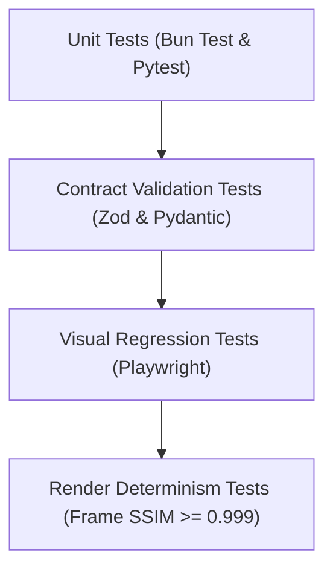

# ENGINEERING & CODING STANDARDS SPECIFICATION

> **Document Version:** 2.0.0  
> **Toolchain:** Bun (v1.1+), Next.js 16 (React 19), FastAPI, TypeScript Strict  
> **Status:** Specification Complete / Greenfield Repository  
> **Parent Context:** [PROJECT.md](../../PROJECT.md)

---

## 1. Codebase Philosophy & Engineering Tenets

1.  **Deterministic Over Ad-Hoc:** All video compositions and animations must be mathematically reproducible. Avoid non-deterministic algorithms or unversioned local assets.
2.  **Feature-Sliced Web Architecture:** All frontend UI logic belongs strictly in `app/features/<feature-name>/`, while external I/O belongs in `app/services/`.
3.  **Local Filesystem Primacy:** Project data lives in `projects/<id>/`. Do not introduce heavyweight external database servers (PostgreSQL/pgvector) or external object stores.
4.  **Zero Hallucinated Implementation:** Code and documentation must reflect only verified, working implementations.

---

## 2. Language-Specific Standards

### 2.1 TypeScript & Next.js 16 (`apps/web`, `apps/render`, `packages/*`)
*   **Package Manager & Runner:** Always use **Bun** (`bun install`, `bun test`, `bun run dev`).
*   **TypeScript Strictness:** `"strict": true`, `"noImplicitAny": true`, `"noUnusedLocals": true`.
*   **Feature Anatomy Standard:**
    Every feature in `apps/web/app/features/` must follow this structure:
    ```text
    app/features/<feature-name>/
    ├── <FeatureName>.tsx       # Container Component (only connects hooks & layout)
    ├── index.ts                # Public API (export FeatureName and public types)
    ├── types.ts                # Internal feature types
    ├── hooks/                  # Custom hooks & business logic
    └── components/             # Presentational components grouped by function
    ```
*   **Services Layer Anatomy:** All REST calls, WebSocket listeners, and file upload clients must live in modular service folders in `apps/web/app/services/<service-name>/`:
    ```text
    app/services/<service-name>/
    ├── index.ts                # Public API (export service instance & public types)
    ├── types.ts                # Kiểu dữ liệu / types của service
    └── <các file nghiệp vụ>    # client.ts, handlers.ts, utils.ts
    ```
*   **Atomic Zustand Selectors:** Always use fine-grained selectors to prevent re-render thrashing during 60fps playback:
    ```typescript
    // Correct
    const currentFrame = usePlaybackStore((state) => state.currentFrame);
    // Forbidden
    const { currentFrame } = usePlaybackStore();
    ```

---

### 2.2 Python Standards (`apps/server`)
*   **Python Version:** Python 3.11+ using native type hints (`list[str]`, `dict[str, Any]`, `T | None`).
*   **Formatting & Linting:** `ruff format` and `ruff check --fix`.
*   **Clean Architecture Decoupling:**
    *   `src/domain/`: Pure standard library Python entities. Zero framework dependencies.
    *   `src/application/`: Orchestrators and use cases.
    *   `src/infrastructure/`: Houses `FileSystemProjectRepository` (reading/writing to `projects/<id>/`), AI diffusion clients, and render IPC handlers.
    *   `src/api/`: FastAPI route controllers.

---

## 3. Testing Strategy



### 3.1 Render Determinism Testing
*   A fixed Scene DSL fixture is rendered twice in succession on the GPU.
*   Extracted frames are compared using **Structural Similarity Index Measure (SSIM)**:
    $$\text{SSIM}(\text{Frame}_A, \text{Frame}_B) \ge 0.999$$
*   Any deviation flags non-deterministic shader math or driver inconsistencies.

---

## 4. Git Commit Standards & Conventions

The repository enforces **Conventional Commits (v1.0.0)** with monorepo-aware scopes to maintain a clean, auditable history and support automated changelog generation.

### 4.1 Commit Message Format
```text
<type>(<scope>): <short description>

[optional body: explain WHAT and WHY, not HOW]

[optional footer(s): BREAKING CHANGE, Closes #123]
```

### 4.2 Standard Types
| Type | Description | Example |
| :--- | :--- | :--- |
| `feat` | New feature or capability | `feat(web): add kinetic typography stagger control` |
| `fix` | Bug fix for broken behavior | `fix(render): resolve NVENC pipe buffer starvation` |
| `docs` | Documentation only changes | `docs(api): update img2img request examples` |
| `style` | Formatting, whitespace, lint fixes (no logic change) | `style(server): run ruff format on storage adapters` |
| `refactor` | Code restructuring without adding features or fixing bugs | `refactor(scene-dsl): simplify AST node visitor logic` |
| `perf` | Performance improvement or memory optimization | `perf(web): use atomic selectors in timeline ruler` |
| `test` | Adding or updating unit/integration/determinism tests | `test(animation): add spring physics overshoot test` |
| `chore` | Toolchain, dependencies, Bun workspace configs | `chore(repo): update Bun workspace dependencies` |
| `ci` | CI/CD pipelines, GitHub Actions workflows | `ci: add automated Playwright visual regression check` |

### 4.3 Monorepo Scopes
Scopes must accurately reflect the affected workspace or domain package:
*   `web` or `web/<feature>` (e.g., `web/scene-editor`, `web/services`)
*   `server` or `server/<module>` (e.g., `server/api`, `server/storage`)
*   `render` (e.g., `render/nvenc`, `render/chromium`)
*   `contracts`: `@video-ai/contracts`
*   `scene-dsl`: `@video-ai/scene-dsl`
*   `animation`: `@video-ai/animation`
*   `preset-apple`: `@video-ai/preset-apple`
*   `assets`: `@video-ai/assets`
*   `docs`: Documentation files (`docs/*`, `PROJECT.md`, `README.md`)
*   `repo`: Root repository configurations

### 4.4 Golden Rules for Commit Messages
1.  **Imperative Mood:** Use the imperative mood in the subject line (`add`, `fix`, `refactor`, not `added`, `fixes`).
2.  **No Trailing Period:** Do not end the subject line with a period `.`.
3.  **Length Limit:** Keep the subject line under 72 characters.
4.  **Atomic Commits:** Each commit must represent a single logical change. Do not mix unrelated refactors with bug fixes.
5.  **Breaking Changes:** Indicate breaking changes with `!` before the colon and describe details in the footer:
    ```text
    feat(scene-dsl)!: redesign camera trajectory schema

    BREAKING CHANGE: camera.keyframes now uses 3D vector coordinates [x, y, z] instead of spherical coordinates.
    ```

---

## 5. Cross-Document References

*   [PROJECT.md](../../PROJECT.md)
*   [CLAUDE.md](../../CLAUDE.md)
*   [apps/web/ARCHITECTURE.md](../../apps/web/ARCHITECTURE.md)
*   [apps/server/ARCHITECTURE.md](../../apps/server/ARCHITECTURE.md)
