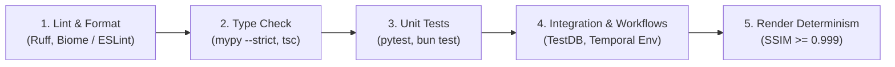

# ENGINEERING & CODING STANDARDS

> **Document Version:** 2.1.0  
> **Status:** Specification Complete / Greenfield Repository  
> **Toolchain:** Python 3.11+, FastAPI, Pydantic v2, SQLAlchemy 2.0, Alembic, Next.js (React 19), TypeScript Strict, Temporal SDK  
> **Parent Context:** [PROJECT.md](../../PROJECT.md) | [SYSTEM_ARCHITECTURE.md](../architecture/SYSTEM_ARCHITECTURE.md)

---

## 1. General Software Engineering Principles

1. **Clean Architecture & Separation of Concerns:**
   Code is structured into concentric layers: **Domain**, **Application (Use Cases/Ports)**, **Infrastructure (Adapters)**, and **Presentation/API**. Inner layers have zero dependencies on outer frameworks.
2. **Deterministic Video Synthesis:**
   All rendering algorithms, scene compilers, and asset transformation scripts must produce mathematically reproducible outputs when supplied identical inputs.
3. **Explicit Over Implicit:**
   Avoid magic globals, monkey-patching, or untyped dynamic dictionaries. Leverage strict static typing across both Python and TypeScript.
4. **Single Responsibility & Modularity:**
   Every class, function, module, and React component must have one, and only one, reason to change.
5. **Fail Fast with Structured Errors:**
   Validate all inputs at the perimeter (using Pydantic in Python and Zod in TypeScript). Emit RFC 7807 compliant Problem Details for API failures.

---

## 2. File Length & Modularity Budgets

To preserve maintainability, simplify code reviews, and optimize AI-assisted pair programming, all source code files must adhere to strict line count limits:

| File Type / Role | Location Pattern | Target Line Count | Strict Hard Limit | Action on Exceeding Limit |
| :--- | :--- | :--- | :--- | :--- |
| **Next.js Page / Shell** | `apps/web/src/app/**/page.tsx` | $\le 100$ lines | **150 lines** | Delegate layout and state to feature containers |
| **Feature Container** | `apps/web/src/features/*/*.tsx` | $\le 120$ lines | **180 lines** | Extract UI regions into sub-components; extract hooks |
| **Presentational Component**| `apps/web/src/features/*/components/**/*.tsx` | $\le 120$ lines | **200 lines** | Decompose into atomic sub-components |
| **Custom Hooks** | `apps/web/src/features/*/hooks/*.ts` | $\le 100$ lines | **160 lines** | Split into composed single-purpose hooks |
| **Client Services / API Clients**| `apps/web/src/services/*/*.ts` | $\le 150$ lines | **220 lines** | Split by entity or domain operation |
| **Python Domain Entities** | `server/src/domain/entities/*.py` | $\le 100$ lines | **150 lines** | Separate value objects from entity roots |
| **Python Use Cases** | `server/src/application/use_cases/*.py` | $\le 120$ lines | **180 lines** | Enforce one use case per file |
| **FastAPI Routers** | `server/src/api/routers/*.py` | $\le 150$ lines | **220 lines** | Decompose into sub-routers by resource |
| **SQLAlchemy Repositories** | `server/src/infrastructure/database/repositories/*.py` | $\le 160$ lines | **240 lines** | Separate queries into dedicated query classes |
| **Temporal Workflows** | `worker/src/workflows/*.py` | $\le 150$ lines | **220 lines** | Decompose complex flows into child workflows |
| **Temporal Activities** | `worker/src/activities/*.py` | $\le 150$ lines | **220 lines** | Extract utility helpers or provider SDK clients |
| **Remotion Compositions** | `apps/video-engine/src/compositions/*.tsx` | $\le 150$ lines | **220 lines** | Separate scene sequences into individual scene components |

> [!IMPORTANT]
> **Universal Absolute Ceiling: 300 Lines**  
> Under no circumstances may any single source code file (`.py`, `.ts`, `.tsx`) exceed **300 lines**. When any file crosses $200$ lines, engineers and AI agents must proactively plan its refactoring and modularization.

---

## 3. Python & FastAPI Conventions (`server`, `worker`)

### 3.1 Python Version & Type Annotations
* **Python Runtime:** Python 3.11+.
* **Native Type Hints:** Use modern standard library type hints (`list[str]`, `dict[str, Any]`, `tuple[int, ...]`, `T | None` instead of `typing.Optional` or `typing.Union`).
* **Strict Type Checking:** Code must pass `mypy --strict`. Dynamic typing (`Any`) is strictly prohibited unless interacting with un-typed third-party libraries.

### 3.2 FastAPI Route Design & Clean Architecture
* **Controller Cleanliness:** FastAPI route handlers must act strictly as HTTP adapters. They validate inputs (via Pydantic), call an Application Use Case, and return a response DTO.
* **No Database Queries in Routers:** Routers must never execute raw SQL or call SQLAlchemy `session.execute()` directly.
* **Asynchronous Execution:** All route handlers and repository operations must be defined with `async def` and use non-blocking asynchronous calls (`await`).

```python
# Example: Correct FastAPI Router Pattern
from fastapi import APIRouter, Depends, status, HTTPException
from server.src.application.use_cases.create_project import CreateProjectUseCase
from server.src.api.dependencies import get_create_project_use_case
from server.src.api.dtos.project import CreateProjectRequestDTO, ProjectResponseDTO

router = APIRouter(prefix="/projects", tags=["Projects"])

@router.post("", response_model=ProjectResponseDTO, status_code=status.HTTP_201_CREATED)
async def create_project(
    payload: CreateProjectRequestDTO,
    use_case: CreateProjectUseCase = Depends(get_create_project_use_case),
) -> ProjectResponseDTO:
    result = await use_case.execute(payload.to_command())
    return ProjectResponseDTO.from_domain(result)
```

### 3.3 Dependency Injection
* Use FastAPI's `Depends` system for injecting database sessions, repository implementations, storage providers, and use cases.
* Define dependency providers in `server/src/api/dependencies.py` to allow seamless swapping with test doubles during testing.

### 3.4 Pydantic v2 & SQLAlchemy 2.0 Mapping
* **Pydantic Models:** Use `BaseModel` with `model_config = ConfigDict(from_attributes=True, extra="forbid")`.
* **SQLAlchemy 2.0 Declarative:** Use `Mapped[...]` and `mapped_column(...)` for all ORM models.

```python
# Example: SQLAlchemy 2.0 Model
from datetime import datetime, timezone
from uuid import UUID, uuid4
from sqlalchemy.orm import DeclarativeBase, Mapped, mapped_column
from sqlalchemy import String, DateTime

class Base(DeclarativeBase):
    pass

class ProjectModel(Base):
    __tablename__ = "projects"

    id: Mapped[UUID] = mapped_column(primary_key=True, default=uuid4)
    name: Mapped[str] = mapped_column(String(255), nullable=False)
    status: Mapped[str] = mapped_column(String(50), default="DRAFT", nullable=False)
    created_at: Mapped[datetime] = mapped_column(
        DateTime(timezone=True), default=lambda: datetime.now(timezone.utc)
    )
```

### 3.5 Error Handling & Structured Logging
* Use **RFC 7807 Problem Details** for HTTP error envelopes:
  ```json
  {
    "type": "https://api.motionstudio.internal/errors/invalid-scene-dsl",
    "title": "Invalid Scene Composition",
    "status": 422,
    "detail": "Scene 3 duration (12 frames) is shorter than transition duration (24 frames).",
    "instance": "/api/v1/projects/550e8400-e29b/scenes"
  }
  ```
* Use structured JSON logging (`structlog` or standard library logging with JSON formatting). Never output raw unstructured `print()` statements.

---

## 4. TypeScript & React Conventions (`apps/web`, `apps/video-engine`)

### 4.1 Strict TypeScript Standards
* **Configuration:** `"strict": true`, `"noImplicitAny": true`, `"noUnusedLocals": true`.
* **Explicit Function Return Types:** All exported functions and hooks must declare explicit return types.
* **No `any` Policy:** Use `unknown` with type guards or Zod schemas instead of `any`.

### 4.2 Feature-Sliced UI Architecture
All frontend code in `apps/web` is organized into self-contained feature slices:

```text
apps/web/src/features/<feature-name>/
├── <FeatureName>.tsx          # Container component (wires hooks to UI)
├── index.ts                   # Public entry point (exports container & public types)
├── types.ts                   # Internal feature domain types
├── hooks/                     # Custom hooks and business logic
│   └── use<FeatureName>.ts
└── components/                # Presentational components
    ├── <SubComponentA>.tsx
    └── <SubComponentB>.tsx
```

* **Container Rule:** `<FeatureName>.tsx` must never contain raw fetch calls, heavy math, or inline styles. Its sole responsibility is wiring custom hooks to presentation components.
* **Public Boundary:** Other parts of the app must import solely from the feature's `index.ts`:
  ```typescript
  // Correct
  import { StoryboardReview } from "@/features/storyboard-review";
  // Prohibited
  import { StoryboardReview } from "@/features/storyboard-review/StoryboardReview";
  ```

### 4.3 Atomic Zustand Selectors
To prevent re-rendering the entire canvas during 60fps playback or scrubbing:
```typescript
// Correct: Only re-renders when currentFrame changes
const currentFrame = useTimelineStore((state) => state.currentFrame);

// Prohibited: Re-renders on any store property change!
const { currentFrame } = useTimelineStore();
```

---

## 5. Temporal Workflow & Activity Conventions (`worker`)

1. **Workflow Determinism Rules:**
   * Workflows must be completely deterministic.
   * **Prohibited in Workflows:** `datetime.now()`, `random()`, network I/O, disk writes, threading, or global state mutation. (Use `workflow.now()`, `workflow.random()`, or delegate to activities).
2. **Activity Design:**
   * All external interactions (Ollama, ComfyUI, Blender, Remotion, FFmpeg, S3) must execute inside an **Activity**.
   * Activities must specify timeouts (`start_to_close_timeout`) and a retry policy (`RetryPolicy(maximum_attempts=3)`).
   * Heartbeat long-running activities (`activity.heartbeat(...)`) every 10–30 seconds during 3D/video rendering.
3. **Idempotency:**
   * Activities must be idempotent so that automatic retries do not produce duplicate assets or corrupt database records.

---

## 6. Project Naming Conventions

| Entity | Convention | Example |
| :--- | :--- | :--- |
| **Python Files / Modules** | `snake_case.py` | `create_project.py`, `storage_service.py` |
| **Python Classes** | `PascalCase` | `ProjectRepository`, `VideoProductionWorkflow` |
| **Python Functions / Methods** | `snake_case` | `execute()`, `render_scene_frame()` |
| **Python Constants** | `UPPER_SNAKE_CASE` | `MAX_CONCURRENT_RENDERS`, `DEFAULT_FPS` |
| **Database Tables** | `plural_snake_case` | `projects`, `scenes`, `approval_gates` |
| **Database Columns** | `snake_case` | `created_at`, `duration_in_frames` |
| **TypeScript Files (Components)**| `PascalCase.tsx` | `TimelineRuler.tsx`, `AssetCard.tsx` |
| **TypeScript Files (Hooks/Utils)**| `camelCase.ts` | `useTimelineScrub.ts`, `formatTime.ts` |
| **TypeScript Interfaces / Types** | `PascalCase` | `SceneNode`, `AssetMetadata` |
| **REST Endpoints** | `kebab-case` nouns | `/api/v1/projects/{id}/render-jobs` |
| **Temporal Task Queues** | `kebab-case` | `video-production-queue`, `render-queue` |

---

## 7. Testing & Code Quality Gates



* **Code Coverage Goal:** $\ge 80\%$ on application use cases, domain entities, and data adapters.
* **Pre-commit Automation:** Code must pass `ruff check`, `ruff format --check`, and `mypy` before pushing commits.

---

## 8. Git & Commit Conventions

The repository strictly enforces **Conventional Commits (v1.0.0)**:
```text
<type>(<scope>): <short description in imperative mood>

[optional body explaining WHAT and WHY, not HOW]

[optional footer(s): BREAKING CHANGE, Closes #42]
```

### 8.1 Allowed Types
* `feat`: New feature or user-facing capability.
* `fix`: Bug fix in application or pipeline logic.
* `docs`: Documentation updates or additions.
* `style`: Code style, formatting, or missing semicolons (no logic change).
* `refactor`: Restructuring code without fixing bugs or adding features.
* `perf`: Performance improvement or GPU memory optimization.
* `test`: Adding or updating unit, integration, or rendering tests.
* `chore`: Maintenance tasks, dependencies, Docker configurations.
* `ci`: CI/CD pipelines and automated workflow scripts.

### 8.2 Standard Monorepo Scopes
* `web`: Next.js frontend (`apps/web`).
* `server`: FastAPI API Gateway (`server`).
* `worker`: Temporal worker daemon (`worker`).
* `video-engine`: Remotion and GSAP motion engine (`apps/video-engine`).
* `packages`: Shared libraries or contracts.
* `infra`: Docker, Docker Compose, Valkey, PostgreSQL, Temporal configs.
* `docs`: Documentation files (`docs/*`, `README.md`, `PROJECT.md`).

---

## 9. Cross-Document Sitemap

* **System Topology & Architecture:** [SYSTEM_ARCHITECTURE.md](../architecture/SYSTEM_ARCHITECTURE.md)
* **Technology Stack & Rationale:** [TECH_STACK.md](../architecture/TECH_STACK.md)
* **Local Setup Guide:** [LOCAL_SETUP.md](LOCAL_SETUP.md)
* **Environment Variables Reference:** [ENVIRONMENT_VARIABLES.md](ENVIRONMENT_VARIABLES.md)
* **Testing Strategy:** [TESTING_STRATEGY.md](TESTING_STRATEGY.md)
* **AI Agent Directives:** [CLAUDE.md](../../CLAUDE.md)
