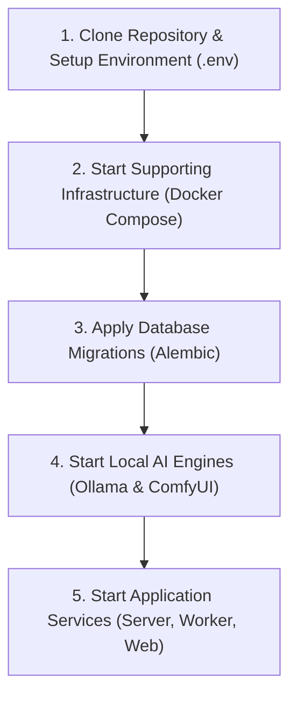

# LOCAL DEVELOPMENT ENVIRONMENT SETUP

> **Document Version:** 1.0.0  
> **Status:** Specification Complete / Greenfield Repository  
> **Toolchain:** Docker Compose, Python 3.11+, Node.js 20+ / Bun 1.1+, Blender 4.x, FFmpeg 6.1+  
> **Parent Context:** [PROJECT.md](../../PROJECT.md) | [CODING_STANDARDS.md](CODING_STANDARDS.md)

---

## 1. Prerequisites & System Requirements

To run the complete **AI Motion Studio** locally (including local AI diffusion, 3D raytracing, and GPU video encoding), ensure your system meets the following specifications:

### 1.1 Hardware Requirements
* **Operating System:** Windows 10/11 (WSL2 recommended for Linux-native tooling), macOS (Apple Silicon M1/M2/M3), or Ubuntu Linux 22.04+.
* **Processor (CPU):** 8 cores minimum (Intel Core i7/i9 or AMD Ryzen 7/9 / Apple Silicon).
* **System Memory (RAM):** 16 GB minimum (32 GB+ recommended for simultaneous 3D rendering and diffusion).
* **Graphics (GPU):**
  * *NVIDIA:* RTX 3060 (12GB VRAM) or higher with CUDA 12.1+ and latest NVIDIA drivers.
  * *Apple Silicon:* M1/M2/M3 Pro/Max with unified memory (Metal acceleration).
* **Storage:** 50 GB free NVMe SSD space (for diffusion weights, Blender caches, and high-res video assets).

### 1.2 Required Software Binaries

| Tool | Minimum Version | Installation Link / Command | Verification Command |
| :--- | :--- | :--- | :--- |
| **Docker Desktop / Engine** | 26.0+ | [docker.com](https://www.docker.com/products/docker-desktop) | `docker --version` |
| **Docker Compose** | v2.27+ | Included with Docker Desktop | `docker compose version` |
| **Python** | 3.11 or 3.12 | [python.org](https://www.python.org/) or `uv` / `pyenv` | `python --version` |
| **Node.js or Bun** | Node 20+ / Bun 1.1+ | [nodejs.org](https://nodejs.org/) or [bun.sh](https://bun.sh/) | `node -v` or `bun -v` |
| **FFmpeg & FFprobe** | 6.1+ (with NVENC) | [ffmpeg.org](https://ffmpeg.org/download.html) | `ffmpeg -version` |
| **Blender** | 4.1+ | [blender.org](https://www.blender.org/download/) | `blender --version` |
| **Ollama (Local LLM)** | 0.1.30+ | [ollama.ai](https://ollama.ai/) | `ollama --version` |
| **ComfyUI (Local Diffusion)** | Latest Git Release | [github.com/comfyanonymous/ComfyUI](https://github.com/comfyanonymous/ComfyUI) | Web UI at `:8188` |

---

## 2. Quickstart Overview



---

## 3. Step-by-Step Installation

### Step 3.1: Clone and Configure Environment
1. Clone the repository and navigate to the project root:
   ```bash
   git clone https://github.com/your-org/video-ai-demo.git
   cd video-ai-demo
   ```
2. Copy the template environment configuration:
   ```bash
   cp .env.example .env
   ```
3. Inspect and adjust `.env` (verify paths to Blender, FFmpeg, and database credentials). See [ENVIRONMENT_VARIABLES.md](ENVIRONMENT_VARIABLES.md) for full parameter definitions.

---

### Step 3.2: Unified Monorepo Runner (Fastest Setup)
From the repository root, you can start both the Next.js 16 Frontend Studio and the FastAPI Backend Gateway simultaneously with a single command:
```bash
# Using Bun or npm from root:
bun run dev
# or using PowerShell on Windows:
powershell -ExecutionPolicy Bypass -File ./scripts/dev.ps1
```

To check and upgrade dependencies across both Web (Node/Bun) and Backend (Python):
```bash
bun run deps:check      # Check latest available versions
bun run deps:upgrade    # Upgrade all dependencies to latest versions
```

---

### Step 3.3: Launch Core Infrastructure with Docker Compose
The project provides a multi-container Docker Compose setup for local infrastructure services:
* **PostgreSQL 16** (Database on port `5432`)
* **Valkey 7** (Cache on port `6379`)
* **Temporal Server & Web UI** (Workflow engine on ports `7233` and `8233`)

Start these background dependencies:
```bash
docker compose -f docker-compose.infra.yml up -d
```

Verify that all three core services are healthy:
```bash
docker compose -f docker-compose.infra.yml ps
```

---

### Step 3.4: Set Up Backend Server (`server/backend`)
1. Create and activate a Python virtual environment:
   ```bash
   python -m venv .venv
   # Windows (PowerShell):
   .venv\Scripts\Activate.ps1
   # Linux / macOS:
   source .venv/bin/activate
   ```
2. Install Backend Python dependencies:
   ```bash
   pip install --upgrade pip
   pip install -r server/backend/requirements.txt
   ```
3. Run Alembic database migrations:
   ```bash
   cd server/backend
   alembic upgrade head
   cd ../..
   ```
4. Start the FastAPI development server with auto-reload:
   ```bash
   cd server/backend
   uvicorn src.main:app --host 0.0.0.0 --port 8000 --reload
   ```
   *FastAPI Interactive Docs:* [http://localhost:8000/docs](http://localhost:8000/docs)

---

### Step 3.5: Set Up AI Engine Services (`server/ai_engine`)
In a separate terminal or virtual environment:
1. Install AI Engine dependencies (Pillow, OpenCV, Ollama client, ComfyUI client):
   ```bash
   pip install -r server/ai_engine/requirements.txt
   ```

---

### Step 3.6: Set Up Temporal Worker Daemon (`worker`)
In a separate terminal (with the virtual environment activated):
1. Install worker dependencies:
   ```bash
   pip install -r worker/requirements.txt
   ```
2. Start the Temporal worker daemon:
   ```bash
   cd worker
   python -m src.main
   ```
3. Open the Temporal Web UI to confirm worker polling on `video-production-queue`:
   *Temporal Web Dashboard:* [http://localhost:8233](http://localhost:8233)

---

### Step 3.7: Set Up Frontend Studio (`apps/web`)
In a separate terminal:
1. Navigate to the web application:
   ```bash
   cd apps/web
   ```
2. Install dependencies using Bun or npm:
   ```bash
   bun install
   # or: npm install
   ```
3. Start the Next.js development server:
   ```bash
   bun run dev
   # or: npm run dev
   ```
4. Access the studio dashboard:
   *Studio UI:* [http://localhost:3000](http://localhost:3000)

---

### Step 3.8: Launch Video Motion Engine Preview (`apps/video-engine`)
To preview or develop Remotion and GSAP compositions independently:
```bash
cd apps/video-engine
bun install
bun run preview
```
*Remotion Preview Player:* [http://localhost:3100](http://localhost:3100)

---

### Step 3.9: Launch Local AI Engines (Ollama & ComfyUI)
1. **Ollama:**
   Pull the default reasoning model:
   ```bash
   ollama pull llama3:8b
   ollama serve
   ```
   *Ollama API:* [http://localhost:11434](http://localhost:11434)

2. **ComfyUI:**
   Start ComfyUI on default port `8188`:
   ```bash
   cd path/to/ComfyUI
   python main.py --listen 127.0.0.1 --port 8188
   ```
   *ComfyUI Interface:* [http://localhost:8188](http://localhost:8188)

---

## 4. Local Port & Service Directory

| Service | Host Port | Protocol | Purpose |
| :--- | :--- | :--- | :--- |
| **Next.js Web Studio** | `3000` | HTTP | Creative Director UI, Storyboard, Timeline |
| **FastAPI Backend** | `8000` | HTTP / WS | REST Endpoints, WebSocket progress updates |
| **Remotion Standalone Preview**| `3100` | HTTP | Motion graphics composition testing |
| **PostgreSQL Database** | `5432` | TCP | Relational data persistence |
| **Valkey Cache** | `6379` | TCP | Session store, locks, rate limits |
| **Temporal Server gRPC** | `7233` | gRPC | Workflow engine communications |
| **Temporal Web UI** | `8233` | HTTP | Workflow execution inspection dashboard |
| **Ollama Local LLM** | `11434` | HTTP | Scene planning & brief expansion |
| **ComfyUI Local Diffusion** | `8188` | HTTP | Image generation & product restyling |

---

## 5. Troubleshooting & Diagnostic Commands

### 5.1 Docker Daemon Not Running
* **Symptom:** `Cannot connect to the Docker daemon at unix:///var/run/docker.sock` or `error during connect`.
* **Fix:** Ensure Docker Desktop is launched and running in the background. On Windows, verify that WSL2 backend integration is enabled in Docker settings.

### 5.2 Database Connection Refused
* **Symptom:** `asyncpg.exceptions.CannotConnectNowError` or `connection to server at "localhost", port 5432 failed`.
* **Fix:** Verify the PostgreSQL container is active:
  ```bash
  docker compose -f docker-compose.infra.yml ps postgres
  ```
  Check database logs:
  ```bash
  docker compose -f docker-compose.infra.yml logs postgres
  ```

### 5.3 Temporal Connection Refused
* **Symptom:** `temporalio.service.RPCError: failed to connect to all addresses`.
* **Fix:** The Temporal server can take 10–15 seconds to finish schema initialization. Wait until `docker compose logs temporal` shows `Server is ready to accept requests`.

### 5.4 Blender CLI Not Found on System PATH
* **Symptom:** `FileNotFoundError: [Errno 2] No such file or directory: 'blender'`.
* **Fix:**
  * *Windows:* Add `C:\Program Files\Blender Foundation\Blender 4.1` to your System `PATH` or specify the exact executable path in `.env`: `BLENDER_PATH="C:/Program Files/Blender Foundation/Blender 4.1/blender.exe"`.
  * *macOS:* Create a symlink:
    ```bash
    sudo ln -s /Applications/Blender.app/Contents/MacOS/Blender /usr/local/bin/blender
    ```
  * *Linux:* `sudo apt install blender` or download from blender.org and link to `/usr/local/bin/blender`.

### 5.5 FFmpeg Missing NVENC Acceleration
* **Symptom:** `Unknown encoder 'h264_nvenc'`.
* **Fix:** Ensure your NVIDIA drivers are up to date. If running on a machine without an NVIDIA GPU (e.g. CPU-only dev machine or Apple Silicon), set `NVENC_ENABLED=false` in `.env`. The worker will automatically fall back to CPU `libx264` (or `h264_videotoolbox` on macOS).

---

## 6. Cross-Document Sitemap

* **System Architecture:** [SYSTEM_ARCHITECTURE.md](../architecture/SYSTEM_ARCHITECTURE.md)
* **Technology Stack:** [TECH_STACK.md](../architecture/TECH_STACK.md)
* **Coding Standards:** [CODING_STANDARDS.md](CODING_STANDARDS.md)
* **Environment Variables:** [ENVIRONMENT_VARIABLES.md](ENVIRONMENT_VARIABLES.md)
* **Testing Strategy:** [TESTING_STRATEGY.md](TESTING_STRATEGY.md)
* **Master Specification:** [PROJECT.md](../../PROJECT.md)
