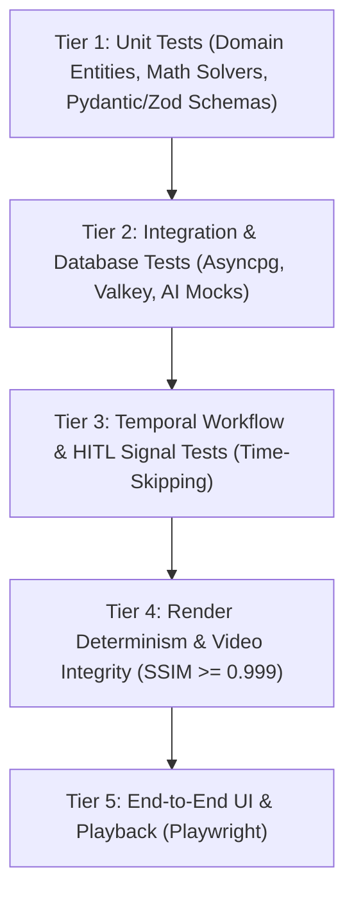
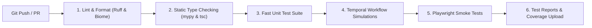

# COMPREHENSIVE TESTING STRATEGY

> **Document Version:** 1.0.0  
> **Status:** Specification Complete / Greenfield Repository  
> **Toolchain:** Pytest, pytest-asyncio, Temporal Testing SDK, Playwright, Bun Test, OpenCV / SSIM  
> **Parent Context:** [CODING_STANDARDS.md](CODING_STANDARDS.md) | [SYSTEM_ARCHITECTURE.md](../architecture/SYSTEM_ARCHITECTURE.md)

---

## 1. Testing Philosophy & Verification Pyramid

Automated video production platforms possess unique quality challenges: in addition to standard API contracts and transactional logic, they generate visual media, coordinate long-running distributed state machines, and interface with heavy GPU workloads.

The **AI Motion Studio** adopts a five-tier testing pyramid to guarantee reliability across all layers:



---

## 2. Testing Tiers & Implementation Specifications

### 2.1 Tier 1: Unit Testing (Fast, Isolated, Zero I/O)
* **Scope:** Domain models, spring physics algorithms, Scene DSL AST parsers, DTO serialization, Pydantic v2 validators, and pure utility functions.
* **Tools:** `pytest` (Python), `bun test` / `vitest` (TypeScript).
* **Guarantees:** Must run in $< 5\text{s}$ across the entire repository. Zero network or database dependencies.

```python
# Example: Domain Unit Test (server/backend/tests/unit/test_scene_dsl.py)
import pytest
from server.backend.src.domain.entities.scene import SceneNode, TransitionConfig

def test_scene_node_validates_minimum_duration():
    with pytest.raises(ValueError, match="durationInFrames must be greater than transition duration"):
        SceneNode(
            id="scene-01",
            duration_in_frames=15,
            transition=TransitionConfig(type="lens-blur", duration_in_frames=24),
        )
```

---

### 2.2 Tier 2: Integration Testing (Database, Cache, and Adapters)
* **Scope:** SQLAlchemy repositories against an isolated test PostgreSQL database, Valkey caching read/write/invalidation, and Provider Adapters.
* **Database Strategy:** Uses transactions rolled back after each test case, or a dedicated ephemeral test database via testcontainers.
* **AI Provider Mocking:** Local diffusion (ComfyUI) and LLM (Ollama) endpoints must never be hit during standard integration tests. Providers implement mock responses via pytest fixtures:

```python
# Example: Mocking AI Provider in Integration Tests (server/ai_engine/tests/test_ollama.py)
import pytest
from unittest.mock import AsyncMock
from server.ai_engine.src.adapters.ollama_adapter import OllamaProvider

@pytest.fixture
def mock_ollama_provider():
    provider = OllamaProvider(base_url="http://mock-ollama:11434")
    provider.generate_scene_storyboard = AsyncMock(
        return_value={
            "scenes": [
                {"title": "Hero Reveal", "duration_frames": 180, "camera": "macro-orbit"}
            ]
        }
    )
    return provider
```

---

### 2.3 Tier 3: Temporal Workflow & HITL Signal Testing
* **Scope:** Multi-step video production state machines, activity retries, timeouts, and Human-in-the-Loop approval/rejection signals.
* **Tool:** `temporalio.testing.WorkflowEnvironment`.
* **Time-Skipping:** Uses Temporal's simulated time environment to test multi-hour workflows and timeout policies in milliseconds.

```python
# Example: Testing HITL Workflow Approval Gate
import pytest
from temporalio.testing import WorkflowEnvironment
from temporalio.worker import Worker
from worker.src.workflows.video_production import VideoProductionWorkflow

@pytest.mark.asyncio
async def test_workflow_pauses_for_hitl_approval_and_resumes():
    async with await WorkflowEnvironment.start_time_skipping() as env:
        async with Worker(
            env.client,
            task_queue="test-video-queue",
            workflows=[VideoProductionWorkflow],
            activities=[...], # Mocked activities
        ):
            handle = await env.client.start_workflow(
                VideoProductionWorkflow.run,
                "project-test-123",
                id="test-run-1",
                task_queue="test-video-queue",
            )

            # Confirm workflow is waiting at approval gate
            describe = await handle.describe()
            assert describe.status.name == "RUNNING"

            # Deliver Human-in-the-Loop Signal
            await handle.signal(VideoProductionWorkflow.submit_approval, "Approved by director")

            # Await workflow completion
            result = await handle.result()
            assert result == "workflow_complete"
```

---

### 2.4 Tier 4: Render Determinism & Video Stream Integrity
* **Scope:** 3D Blender frame sequences, Remotion kinetic typography rendering, and final FFmpeg video muxing.
* **Determinism Testing via SSIM:**
  * To guarantee that rendering is reproducible, a standardized test scene DSL is rendered twice under identical conditions.
  * Extracted frames are analyzed using the **Structural Similarity Index Measure (SSIM)** via OpenCV:
    $$\text{SSIM}(\text{Frame}_A, \text{Frame}_B) \ge 0.999$$
* **Stream Integrity Testing:**
  * FFprobe verifies container syntax, video codec (`h264`), resolution (3840x2160 or 1920x1080), exact frame rate (60.00 fps), and audio stream presence.

```python
# Example: Determinism Verification via OpenCV SSIM
import cv2
import numpy as np
from skimage.metrics import structural_similarity as ssim

def assert_frames_are_identical(frame_path_a: str, frame_path_b: str):
    img_a = cv2.imread(frame_path_a)
    img_b = cv2.imread(frame_path_b)
    gray_a = cv2.cvtColor(img_a, cv2.COLOR_BGR2GRAY)
    gray_b = cv2.cvtColor(img_b, cv2.COLOR_BGR2GRAY)

    similarity_score, _ = ssim(gray_a, gray_b, full=True)
    assert similarity_score >= 0.999, f"Non-deterministic render detected! SSIM: {similarity_score}"
```

---

### 2.5 Tier 5: End-to-End (E2E) Studio UI Testing
* **Scope:** Full user journeys in the Next.js web application (`apps/web`).
* **Tool:** Playwright.
* **Key Flows Tested:**
  1. Creative Brief intake: filling project title, color palette, uploading product image.
  2. Storyboard approval modal: receiving WebSocket notification, reviewing scene cards, submitting feedback.
  3. Interactive Dual Editor: scrubbing the Remotion timeline, toggling layer visibility.
  4. Export trigger: requesting 4K master export and confirming progress bar update.

---

## 3. Test Execution Commands

### 3.1 Backend & Worker Testing (Pytest)
```bash
# Run all unit tests across backend, ai_engine, and worker
pytest server/backend/tests/unit server/ai_engine/tests/unit worker/tests/unit -v

# Run integration tests (requires Docker infra running)
pytest server/backend/tests/integration -v

# Run Temporal workflow tests with time-skipping
pytest worker/tests/workflows -v

# Generate test coverage report
pytest --cov=server/backend/src --cov=server/ai_engine/src --cov=worker/src --cov-report=html
```

### 3.2 Frontend & Motion Engine Testing (Bun / Playwright)
```bash
# Run frontend unit & component tests
cd apps/web && bun test

# Run video-engine composition tests
cd apps/video-engine && bun test

# Run E2E user journey tests with Playwright
cd apps/web && bun run test:e2e
```

### 3.3 Render Determinism Suite
```bash
# Execute standalone render determinism verification
python scripts/test_render_determinism.py --fixture tests/fixtures/sample_scene.json
```

---

## 4. Continuous Integration (CI) Pipeline Strategy



> [!NOTE]
> GPU-dependent tasks (live diffusion sampling and 4K Blender renders) are excluded from standard cloud pull-request CI to maintain fast build times ($< 3\text{ minutes}$). Full GPU regression suites run nightly on dedicated on-premise GPU runners.

---

## 5. Cross-Document Sitemap

* **System Architecture:** [SYSTEM_ARCHITECTURE.md](../architecture/SYSTEM_ARCHITECTURE.md)
* **Local Setup Guide:** [LOCAL_SETUP.md](LOCAL_SETUP.md)
* **Environment Variables:** [ENVIRONMENT_VARIABLES.md](ENVIRONMENT_VARIABLES.md)
* **Coding Standards:** [CODING_STANDARDS.md](CODING_STANDARDS.md)
* **Master Specification:** [PROJECT.md](../../PROJECT.md)
