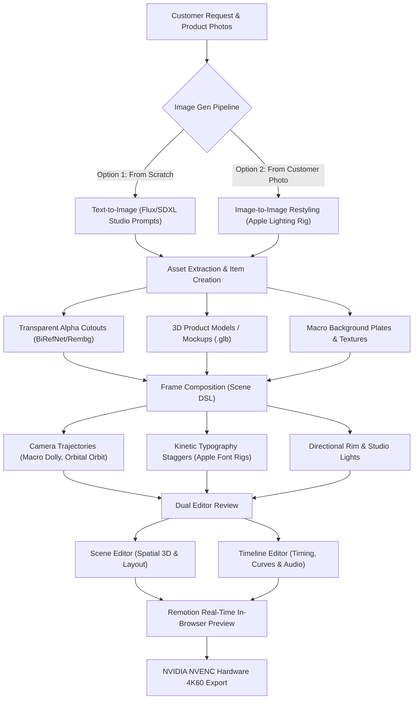
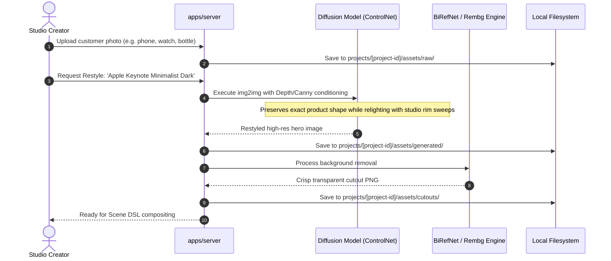

# AI PRODUCTION WORKFLOWS & IMAGE-TO-VIDEO PIPELINE

> **Document Version:** 2.0.0  
> **Target Aesthetic:** Apple Keynote & iPhone Launch Trailer Precision  
> **Status:** Specification Complete / Greenfield Repository  
> **Parent Context:** [PROJECT.md](../../PROJECT.md)

---

## 1. Executive Summary & Studio Workflow Purpose

This document details the practical, production-oriented workflow of the studio tool. The platform is designed to take client requests, brand requirements, and optional **customer product photos**, process them through generative AI and vision models, and synthesize them into cinematic, Apple-style product intro trailers with buttery-smooth spring physics, dynamic rim lighting, and 4K60 video export.



---

## 2. Customer Photo Restyling & Asset Extraction

### 2.1 The Challenge of Customer Photos
Client-supplied product photos typically suffer from harsh room lighting, cluttered backgrounds, low dynamic range, or awkward angles. The tool converts these into keynote-grade visual assets via a two-stage process:



### 2.2 Image-to-Image Restyling Prompt Parameters
```yaml
prompt: >
  macro product photography of {productName}, sleek metallic finish, 
  precise chamfered edges, volumetric cyan rim lighting, 
  pure black studio backdrop, subtle ground reflection, octane render, 8k, photorealistic
negative_prompt: >
  cluttered background, harsh flash glare, noisy, blurry, deformed geometry, text, watermark
controlnet_type: "depth_midas"
denoising_strength: 0.42
```

---

## 3. Frame & Scene Composition (Declarative Scene DSL)

Once assets and items (cutouts, textures, 3D `.glb` meshes) are created, the tool arranges them into cinematic scenes within `projects/<id>/scenes.json`:

### 3.1 Classic 6-Scene Apple Trailer Anatomy
1.  **Scene 1: The Dark Silhouette (0–3s):** Pure black screen. Soft rim light sweeps along the product contour as camera dollies forward. Single-word headline: *"Titanium."*
2.  **Scene 2: Macro Engineering Detail (3–7s):** Extreme close-up on precision texture, button, or camera bevel. Kinetic text staggers: *"Engineered to endure."*
3.  **Scene 3: Exploded Architecture / Component Snap (7–12s):** Internal components or product layers expand spatially and snap back into place with spring physics ($\zeta \approx 0.85$).
4.  **Scene 4: Dynamic Lighting Orbit (12–18s):** $360^\circ$ orbital camera sweep around 3D hero model, showcasing dynamic specular reflections and glass refractions.
5.  **Scene 5: Feature Montage (18–24s):** Fast rhythmic cuts timed to audio beat drops, displaying key capability badges.
6.  **Scene 6: Hero Lockup & Call-to-Action (24–30s):** Full product hero shot centering with clean Apple-style title and brand logo lockup.

---

## 4. Dual-Editor Interaction & Final Synthesis

*   **Scene Editor:** Creator inspects 3D product angles, tweaks rim light color and intensity, and adjusts typography position.
*   **Timeline Editor:** Creator fine-tunes transition durations, adjusts spring stiffness/damping, and aligns visual cuts with background music beats.
*   **Render Execution:** Remotion renders frames into NVIDIA NVENC hardware encoder for final 4K60 MP4 export.

---

## 5. Cross-Document References

*   [PROJECT.md](../../PROJECT.md)
*   [API_CONTRACTS.md](../api/API_CONTRACTS.md)
*   [apps/web/ARCHITECTURE.md](../../apps/web/ARCHITECTURE.md)
*   [RENDERING_PIPELINE.md](../architecture/RENDERING_PIPELINE.md)
