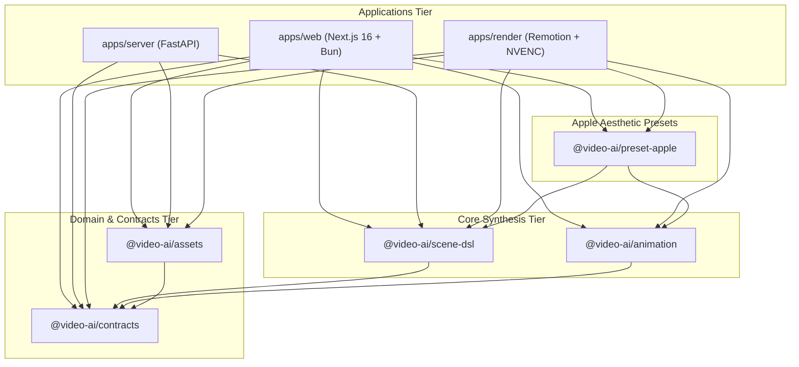

# SHARED PACKAGES ARCHITECTURE SPECIFICATION: `packages/*`

> **Document Version:** 2.0.0  
> **Workspace Tooling:** Bun Workspaces, TypeScript (Strict Mode)  
> **Status:** Specification Complete / Greenfield Repository  
> **Parent Context:** [PROJECT.md](../PROJECT.md)

---

## 1. Monorepo Package Topology & Dependency Inversion

The `packages/` directory contains cross-cutting domain libraries shared between `apps/web`, `apps/server`, and `apps/render`. 

Adhering strictly to a **Directed Acyclic Graph (DAG)**:
1.  **Zero Downward Coupling:** Shared packages never import or reference code in `apps/*`.
2.  **Universal Bun Compatibility:** All packages are authored in TypeScript and run natively under Bun or compile to ESM via `tsup`.
3.  **Strict Typing:** Full type safety enforced via shared `tsconfig.base.json`.



---

## 2. Implementation Status & Repository Baseline

| Package Name | Architecture Role | Target Technologies | Repository State | Verification |
| :--- | :--- | :--- | :--- | :--- |
| **`@video-ai/contracts`** | Shared DTOs, API & WS events | TypeScript, Zod | **Planned (0% Implemented)** | Directory unpopulated |
| **`@video-ai/scene-dsl`** | Scene AST, Schema, Validator | TypeScript, Zod | **Planned (0% Implemented)** | Directory unpopulated |
| **`@video-ai/animation`** | Spring physics, easing math | TypeScript, Math3D | **Planned (0% Implemented)** | Directory unpopulated |
| **`@video-ai/assets`** | Local path helpers, media meta | TypeScript | **Planned (0% Implemented)** | Directory unpopulated |
| **`@video-ai/preset-apple`** | Studio Rigs, Fonts, Shaders | Three.js / Remotion | **Planned (0% Implemented)** | Directory unpopulated |

---

## 3. Package Specifications & Responsibilities

### 3.1 `@video-ai/contracts`
Provides the shared runtime validation schemas and TypeScript types:
*   `ProjectDTO`, `CreateProjectSchema`, `UpdateBriefSchema`
*   `GenerateAssetSchema`, `CutoutRequestSchema`
*   `RenderJobRequestSchema`, `RenderProgressEventSchema`
*   `WebSocketMessageEnvelope<T>`

```typescript
// packages/contracts/src/asset.ts
import { z } from 'zod';

export const GenerateAssetSchema = z.object({
  projectId: z.string(),
  mode: z.enum(['txt2img', 'img2img']),
  sourceAssetPath: z.string().optional(),
  prompt: z.string().min(3),
  stylePreset: z.enum(['apple-dark-studio', 'apple-light-studio', 'macro-detail']).default('apple-dark-studio'),
});

export type GenerateAssetPayload = z.infer<typeof GenerateAssetSchema>;
```

---

### 3.2 `@video-ai/scene-dsl`
The declarative AST defining video scenes, kinetic layers, and camera trajectories:
*   Schema definitions for `SceneCompositionDSL`, `SceneNode`, `CameraConfig`, `LightingConfig`.
*   Layer definitions: `ImageLayerNode`, `TextLayerNode`, `Model3DLayerNode`, `ShapeLayerNode`.
*   Helper utilities for inserting layers, computing frame offsets, and serializing to `scenes.json`.

---

### 3.3 `@video-ai/animation`
The mathematical engine for Apple-style fluid motion:
*   **Second-Order Spring Solver:** Evaluates position and velocity given `mass`, `stiffness`, and `damping`.
*   **Cubic Bezier Spline Evaluator:** Precision easing functions matching CSS curves.
*   **Catmull-Rom Camera Splines:** Smooth 3D camera sweeps and orbital rotations around hero models.

---

### 3.4 `@video-ai/preset-apple`
Pre-engineered design kits capturing the Apple keynote visual signature:
*   **Studio Lighting Rigs:** Preset 3-point setups with soft ground contact shadows and high-contrast specular rims.
*   **Kinetic Typography Presets:** Staggered reveals, tracking expansion, and vertical mask wipe effects.
*   **Metallic PBR Shaders:** Custom Three.js materials for anodized aluminum, titanium, and frosted glass.

---

### 3.5 `@video-ai/assets`
Filesystem path resolution and media utilities:
*   Local path normalizer: resolves `projects/<id>/assets/cutouts/<filename>` references.
*   Image dimension, aspect ratio, and alpha-channel transparency validators.

---

## 4. Cross-Document References

*   [PROJECT.md](../PROJECT.md)
*   [apps/web/ARCHITECTURE.md](../apps/web/ARCHITECTURE.md)
*   [apps/render/ARCHITECTURE.md](../apps/render/ARCHITECTURE.md)
